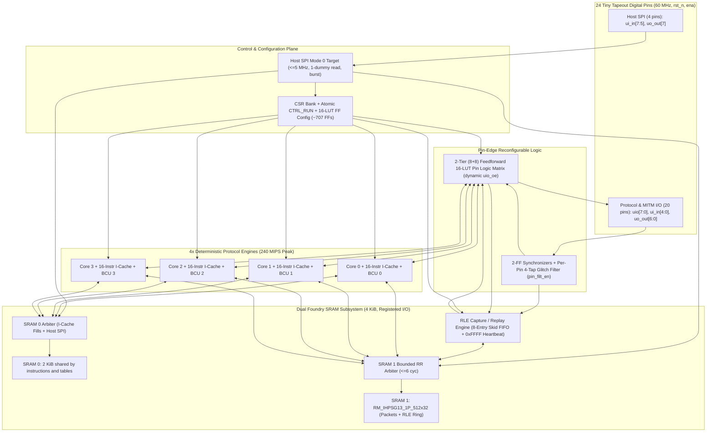
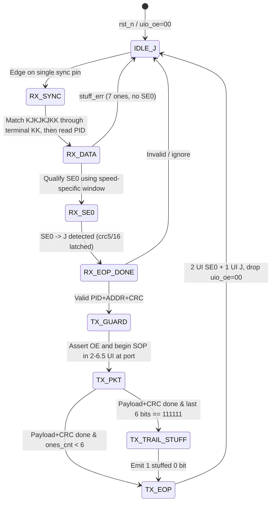
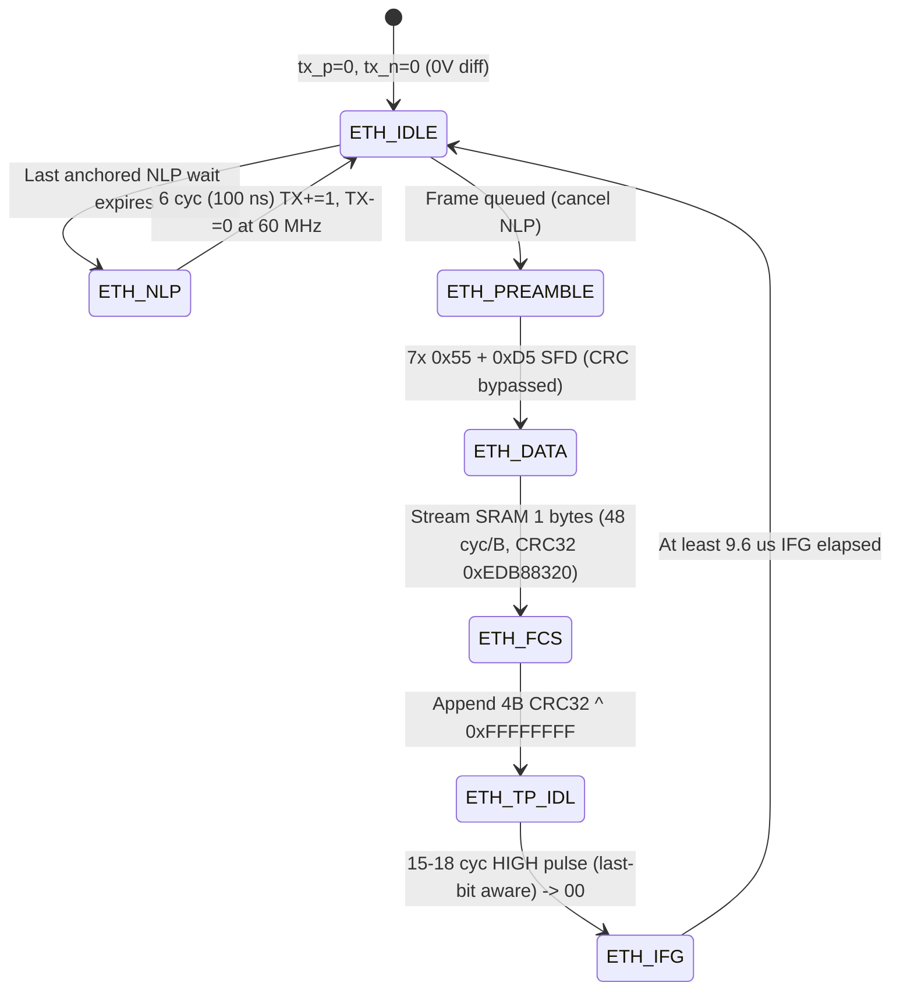
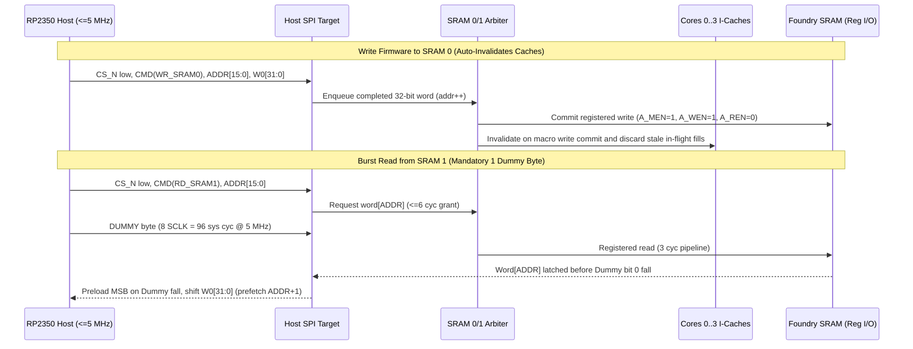
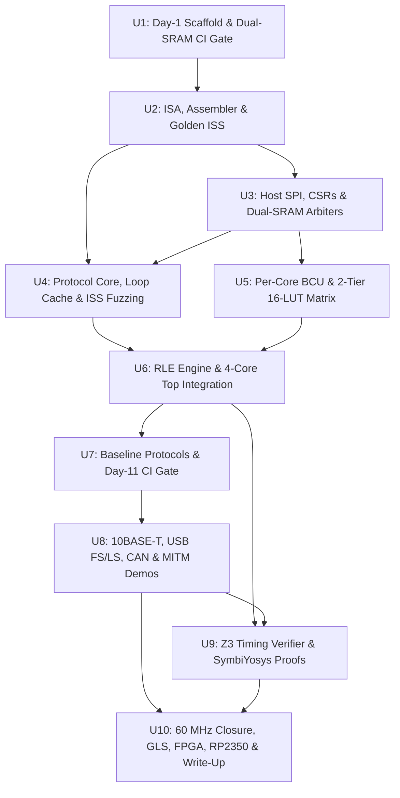

# Hamming Protocol Emulator ASIC - Plan

## Goal Capsule

- **Objective:** Deliver a public, precheck-passing, post-fabrication reprogrammable general-purpose protocol emulator ASIC (**Hamming**, `tt_um_akorite_hamming`) for the Jane Street Protocol Emulator ASIC Competition on Tiny Tapeout's IHP 130nm `ihp-sg13cmos5l` `8x4` shuttle, capable of emulating baseline and wire-speed protocols plus live hardware reverse-engineering workflows in silicon and on a later FPGA board.
- **Means:** A 60 MHz four-core deterministic deadline-timed protocol engine paired with four parameterized bitstream conditioning units, a fixed 2-tier 16-LUT pin logic matrix, dual foundry `512x32` SRAM macros (4 KiB total) for code, packet frames, and RLE waveform capture/replay, a Python assembler with Z3 static timing verification, and SymbiYosys formal plus gate-level sign-off (KTD1–KTD11).
- **Authority hierarchy:** Product Contract (`R1`–`R20`) governs observable behavior and competition deliverables; Planning Contract (`KTD1`–`KTD11`) governs hardware and toolchain mechanisms within those constraints; Implementation Units (`U1`–`U10`) carry unit-local deltas and override neither.
- **Execution profile** — The worker uses a single incremental branch. Qualify dual SRAM in official CI by Day 2 (U1), save a green Day 11 baseline commit (U7), and freeze the release candidate on Day 21 (U10).
- **Stop conditions** — Escalate if U1 cannot qualify two independent 2 KiB SRAM banks on the official flow, CI cannot run under the confirmed GitHub account, or the required protocols cannot meet timing at 60 MHz or a fully revalidated clock of at least 48 MHz (SC1). Keep the last green milestone available. A single or smaller-capacity SRAM prototype can diagnose a U1 failure. Any release using reduced memory needs an explicit capacity and protocol decision.
- **Ownership** — The user hands U1–U10 to a worker agent, reviews milestone evidence, runs physical FPGA tests once hardware arrives, and submits the competition form by **January 18, 2027 at 11:59 p.m. AoE (UTC−12)**. That is January 19 at 18:59 WIB in Jakarta. The organizer will add the submission form closer to the deadline.

---

## Product Contract

### Summary

Hamming (`tt_um_akorite_hamming`) is an open-source, post-fabrication reprogrammable protocol emulator and hardware debugging ASIC targeting Tiny Tapeout's 8x4 IHP 130nm CMOS5L shuttle at 60 MHz. It combines four cycle-deterministic protocol engines, parameterized bitstream conditioning, a loop-free 16-LUT pin logic matrix, and 4 KiB of dual foundry SRAM with a Z3-verified protocol toolchain, SymbiYosys formal proofs, cocotb bus models, and post-place-and-route gate-level simulation. The FPGA synthesis path is part of the submission. Physical FPGA validation follows board availability.

### Problem Frame

Jane Street plans to fund roughly four open-source designs on the March 2027 CMOS5L shuttle. Judging gives priority to post-fabrication flexibility and considers demonstrated protocols, novel capabilities, verification, and the clarity of the write-up. [Competition FAQ](https://blog.janestreet.com/protocol-emulator-asic-competition/#faq)

Hamming uses deadline scheduling and configurable bitstream operations to let firmware meet wire timing while retaining programmable control over each protocol. The three-week build targets the Day 11 baseline and Day 21 submission candidate, with roughly five weeks before the competition deadline.

### Key Decisions

- **Pure-Windows local EDA without WSL** — Native Windows OSS CAD Suite (`C:\tools\oss-cad-suite`) plus project-local `uv` `.venv` (`cocotb 2.0.1`, `pytest 8.4.2`) handles local simulation, synthesis, and formal proofs, while Tiny Tapeout GitHub Actions runs LibreLane GDS, precheck, and gate-level simulation. (session-settled: user-directed — chosen over WSL2 Ubuntu and Icarus-only: avoids WSL overhead while keeping local synthesis and formal tools under 1 GB archive size.) Governs R16, R17, R19.
- **3-week worker-agent crunch schedule** — Target a 21-day build with approximately five weeks before the submission deadline. (session-settled: user-directed — chosen over an 8-week schedule: reaches submission-ready silicon and write-up inside the 3-week window.) Governs R1, R12, R20.
- **Full four-moonshot foundry-SRAM architecture** — Build dual foundry SRAM macros, a loop-free 16-LUT pin logic matrix, wire-speed bitstream conditioning (targeting 12 Mbps Full-Speed USB and 10BASE-T Ethernet), an on-chip RLE logic analyzer/MITM fault injector, and a Z3 timing-verified compiler. (session-settled: user-directed — chosen over a pure-standard-cell baseline without hard SRAM: maximizes competition differentiation using Tiny Tapeout's official CMOS5L SRAM flow.) Governs R2, R3, R4, R5, R6, R7, R13, R14, R15.
- **Chip codename Hamming and FPGA portability** — Top module is `tt_um_akorite_hamming`, and RTL uses single-clock synthesizable Verilog-2005 with a swappable SRAM wrapper so an FPGA board arriving later can run the exact same logic. Governs R1, R18.
- **Four-pin host SPI partition** — Reserve `ui_in[7:5]` and `uo_out[7]` for the RP2350 host loader and control bus, leaving all 8 bidirectional `uio[7:0]` pins plus 12 unidirectional pins (20 total) free for protocols and MITM passthrough. Governs R8.

### Requirements

**Silicon Platform & Reset Safety**
- R1. The design targets Tiny Tapeout IHP 130nm `ihp-sg13cmos5l` (`8x4` tiles, `1724.16 x 710.64 um`, top module `tt_um_akorite_hamming`) with 60 MHz nominal and the SC1 sign-off clock. It passes the official `ttihp27a` GDS build, precheck, and gate-level simulation.
- R2. Hardware reset (`!rst_n`) places all cores in `HALTED`, drives `uio_oe` to `8'h00`, drives `uo_out` to `8'h00`, disables the RLE engine and SRAM chip enables (`A_MEN = 0`), and prevents uninitialized foundry SRAM (`32'bx`) from reaching any output pin.
- R3. While continuously powered, `ena == 0` isolates Host SPI input traffic, halts new core/RLE operations, and releases the pins. Tiny Tapeout powers down deselected designs. After hardware reselection, the host resets Hamming and reloads firmware, SRAM data and configuration before asserting `CTRL_RUN`.

**Programmable Protocol Compute & Bitstream Fabric**
- R4. Four identical, cycle-deterministic 16-bit protocol cores execute concurrently at the release clock with local zero-wait loop caching, hardware deadline scheduling (`WAIT_PHASE` and `SYNC_EVENT` with signed modular comparison and a sticky `deadline_missed` flag), and atomic multi-core start via a single control register.
- R5. Four dedicated, software-parameterized Bitstream Conditioning Units (one per core) provide arbitrary-polynomial serial CRC/LFSR (1–32 bits, both LSB-first right-shift reflected and MSB-first left-shift), programmable line coding (NRZ, NRZI, IEEE 802.3 Manchester, Differential Manchester, PWM/RZ), programmable bit-stuffing/unstuffing (both 6-ones-only for USB and 5-both-polarity for CAN), non-byte transfer widths (1–16 bits), independent `(tx_p, tx_n, tx_oe)` outputs, pattern matching, and edge-locking DPLLs (edge-priority hard-snap and hold-off bit-center modes).
- R6. A loop-free, fixed 2-tier (`8 + 8`) 16-LUT Programmable Pin Logic Matrix sits between the 20 protocol pins and internal engines, configured in CSR flip-flops, with optional per-LUT output registers, per-pin configurable 4-tap glitch filtering (`pin_filt_en[7:0]`), and dynamic per-cycle `uio_oe` control for open-drain and half-duplex buses.
- R7. Two independent 2 KiB foundry SRAM banks provide SRAM 0 (a shared 2 KiB budget for up to 1,024 16-bit instructions and any readable lookup/descriptor tables) and SRAM 1 (2 KiB partitioned for packets and RLE capture/replay). Each bank sustains one grant per cycle under its own bounded arbiter. U1 may qualify another macro geometry that preserves those interfaces and capacity.

**Host Control & Reverse-Engineering Instrument**
- R8. A synchronous Host SPI Mode 0 target (`ui_in[7:5]` for `CS_N`/`SCLK`/`MOSI`, `uo_out[7]` for `MISO`, up to 5 MHz) loads SRAM 0/1, configures CSRs and the 16-LUT matrix, starts/halts cores atomically, reads back status and buffers using 1 dummy byte on reads and 32-bit auto-incrementing bursts, and discards partial writes on early `CS_N` deassertion.
- R9. A committed SRAM 0 write or soft reset invalidates all four instruction loop caches. The core cannot retire a stale fetch after commit. The host halts the affected cores before replacing a multiword firmware image, then starts them after loading completes.
- R10. The on-chip RLE Logic Analyzer and Waveform Replay engine shares SRAM 1 through an aligned power-of-two window (`rle_base`, `rle_mask`). It uses an eight-entry FIFO and sticky overflow/underflow status. Each record stores `{delta[15:0], probe[15:0]}`. Capture and replay are mutually exclusive. A LUT trigger can start or stop capture.
- R11. Live man-in-the-middle (MITM) fault injection supports both 1-cycle LUT-gated intercept (with direction-gated `oe` and turnaround deadtime on bidirectional buses to prevent latchup) and dual-core cut-through/store-and-forward byte or CRC corruption while capturing bus reactions into SRAM 1.

**Demonstrated Protocols (Firmware + Independent BFMs)**
- R12. Firmware implements full-duplex UART with framing and parity error cases, SPI modes 0–3 (10 MHz controller baseline and 5 MHz target at the nominal clock, with 15 MHz controller characterization), and I2C at 100/400 kHz with open-drain operation, clock stretching and multi-master arbitration. Verify against independent cocotb BFMs and demonstrate all four cores running concurrently by Day 11.
- R13. 10BASE-T Ethernet runs TX and RX concurrently with independent `(tx_p, tx_n)` for Manchester signaling and 3-state TP_IDL, normal link pulses near 16 ms, SFD `0xD5`, reflected CRC-32 (`0xEDB88320`, pre-XOR residue `0xDEBB20E3`), at least 9.6 µs IFG, and full-frame buffering and autonomous reply in SRAM 1.
- R14. Stretch firmware runs Low-Speed (1.5 Mbps) and Full-Speed (12 Mbps) USB device transactions. The nominal 60 MHz symbol periods are 40 and 5 cycles, respectively. Validate both speeds with edge recovery, NRZI, 6-ones bit stuffing, valid `SE0` and `J` EOP handling, zero-length DATA packets, and hardware CRC5/CRC16. Check bus turnaround at the external bus boundary using each speed's bit time.
- R15. Generality and reverse-engineering demos include CAN 2.0A (up to 1 Mbps, 5-bit both-polarity stuffing, MSB-first CRC-15 `0x4599`, wired-AND arbitration, ACK turnaround) and a live MITM fault-injection plus RLE capture/replay test.

**Toolchain, Formal Verification, Portability & Deliverables**
- R16. A Python toolchain (`tools/`) generated from a single-source-of-truth ISA definition provides an assembler (with symbolic timing directives `@baud`, `@us`), disassembler, cycle-accurate Golden ISS, and a `z3-solver` static timing verifier modeling loop-cache misses, arbiter stalls, and pad/sync delays.
- R17. Verification spans four layers: 100,000+ cycles of constrained-random RTL-vs-ISS differential fuzzing in cocotb 2.0.1, five modular SymbiYosys formal proofs (`sram_arb`, `lut_matrix`, `bcu_stuffer`, `bcu_dpll`, `deadline_sched`) with `bmc`, `prove`, and `cover`, independent protocol BFMs, and pin-only post-P&R gate-level simulation (`gl_test`).
- R18. All synthesizable RTL adheres to clean Verilog-2005 with a single macro switch (default = IHP SRAM macro, `-DTARGET_FPGA` = portable synchronous BRAM inference, `-DFORMAL` = bounded formal memory stub) plus a generic FPGA wrapper ready for board-specific pin mapping later.
- R19. Local Windows testing runs natively via `pytest` + `cocotb_tools.runner.get_runner("icarus")` (zero GNU Make/WSL), while `test/Makefile` runs the exact same pin-only `test/test.py` on Tiny Tapeout's Linux CI with `cocotb==2.0.1` pinned.
- R20. Competition deliverables include an RP2350 MicroPython host loader/RLE client, complete `info.yaml` and `docs/info.md` passing precheck, architecture and ISA documentation, Pmod electrical hookup notes (pull-ups, USB resistors, 10BASE-T magnetics/comparator), verification methodology write-up, and transparent AI-usage disclosure.

### Success Criteria

- SC1. Tiny Tapeout `gds`, `precheck`, and `gl_test` pass with clean DRC/LVS, connected macro supply rails, and non-negative setup and hold at the release clock across the enabled sign-off corners. Target 60 MHz (`16.667 ns`). A lower release clock is eligible only at `>= 48 MHz` after firmware, pin timing, BFMs, formal and Z3 timing checks, and host configuration all pass at that frequency. Record one release clock across `info.yaml`, constraints, build tooling, and the driver. Verify transmitted 10BASE-T edge placement as well as RX recovery before accepting any derating.
- SC2. Every protocol firmware suite (UART, SPI 0–3 controller/target, I2C 100/400k + stretch + arb, 10BASE-T TX/RX + ARP/ping reply, LS + FS USB device transaction, CAN 2.0A, and MITM fault injection + RLE capture) passes 100% locally in `pytest` and its pin-only subset passes under `GATES=yes` in CI within 15 minutes.
- SC3. All five SymbiYosys `.sby` harnesses pass `bmc`, `prove`, and `cover`, and the Z3 timing verifier proves every shipped protocol program meets its datasheet timing bounds with zero `deadline_missed` assertions.
- SC4. A fresh reviewer or judge can clone the public repository, run the local test/assembler/Z3 commands from `README.md`, and understand the ISA, hardware architecture, verification evidence, and Pmod requirements without asking follow-up questions.

### Key Flows

- F1. Boot, Program Load, and Live Re-Flash
  - **Trigger:** Power-on reset (`rst_n: 0 -> 1`) or post-deselection re-entry (`ena: 0 -> 1`) on the Tiny Tapeout demo board.
  - **Actors:** RP2350 host controller, Host SPI target, SRAM 0/1 arbiters, four Protocol Cores.
  - **Steps:** The host selects the design, holds `HOST_CS_N` high through reset, then loads SRAM 0 firmware, SRAM 1 initial contents, and LUT/BCU/pin configuration. After the load completes, one `CTRL_RUN` write launches the selected cores and/or capture.
  - **Outcome:** Selected cores start in phase-locked lockstep with zero X-propagation and zero stale-cache hazards.
  - **Covered by:** R2, R3, R8, R9, R4.

- F2. High-Speed Wire Protocol Transaction (FS USB 12 Mbps & 10BASE-T Ethernet)
  - **Trigger:** Host/peer drives SYNC (`K J K K`) or Ethernet Preamble (`0x55`) onto configured protocol pins.
  - **Actors:** Pin synchronizers, 16-LUT Matrix, Per-Core BCU, Protocol Core, SRAM 1 Packet Buffer.
  - **Steps:** BCU DPLL locks onto wire edges, strips coding/stuffing, checks hardware CRC on the fly, and transfers bytes to the core's shadow buffer; on EOP/EOF the core evaluates `crc_ok` from its 0-wait loop cache within the protocol turnaround window and triggers hardware-coded TX reply (`DATA0`/`ACK` or Ethernet frame + `TP_IDL`) from SRAM 1.
  - **Outcome:** Full wire-speed framing, error checking, and turnaround complete on silicon without host real-time involvement.
  - **Covered by:** R4, R5, R6, R7, R13, R14.

- F3. Live MITM Protocol Fault Injection & RLE Capture
  - **Trigger:** External bus traffic between Device A and Device B enters Hamming while RLE capture is armed on a LUT trigger predicate.
  - **Actors:** Device A, Device B, 16-LUT Matrix, Core 0 (snoop/trigger), Core 1 (fault/re-tx), RLE Engine, SRAM 1, RP2350 host.
  - **Steps:** Port A traffic passes through direction-gated LUTs (or regenerative dual-core cut-through) to Port B; Core 0 matches target byte/address/CRC and asserts fault override (bit flip, CRC corruption, or exact-cycle clock stretch); RLE Engine records triggered pin deltas via its skid FIFO into SRAM 1's ring partition; RP2350 bursts the RLE trace out over Host SPI for decoding.
  - **Outcome:** Surgical wire-speed fault injection and cycle-accurate waveform capture occur without bus latchup or packet-buffer corruption.
  - **Covered by:** R6, R7, R8, R10, R11, R15.

- F4. Dual-Target ASIC CI & FPGA Portability Flow
  - **Trigger:** Worker agent commits RTL or test updates and pushes to GitHub (or synthesizes for FPGA later).
  - **Actors:** Worker agent, Windows local `pytest`/`yosys`/`sby`, GitHub Actions `tt-gds-action@ttihp27a`, future FPGA toolchain.
  - **Steps:** Native Windows runs the RTL simulator, Yosys, and the ISS, Z3 and SymbiYosys suites. GitHub Actions runs CMOS5L hardening, precheck, and pin-only functional `gl_test` with the associated IHP SRAM models. FPGA builds select `-DTARGET_FPGA` for synchronous block RAM inference.
  - **Outcome:** Silicon readiness is verified continuously from Day 1 while preserving clean FPGA portability.
  - **Covered by:** R1, R17, R18, R19.

### Acceptance Examples

- AE1. Safe Reset With Uninitialized Foundry SRAM
  - **Covers:** R2, R3.
  - **Given:** Both SRAM 0 and SRAM 1 contain `32'bx` at `t=0` in gate-level simulation and `rst_n` pulses low then high.
  - **When:** 200 clock cycles elapse with random toggling on `ui_in` while `ena == 0` and then `ena == 1` with `HOST_CS_N == 1`.
  - **Then:** `uo_out`, `uio_out`, and `uio_oe` remain strictly known (`8'h00`, zero `X` bits), SRAM `A_MEN` stays `0`, and all four cores remain `HALTED`.

- AE2. Host SPI Burst Readback With Mandatory Dummy Byte
  - **Covers:** R8, R9.
  - **Given:** Core 0 is executing a tight loop from SRAM 0 while RLE capture is writing SRAM 1.
  - **When:** The host executes a 5 MHz Mode 0 SPI write burst to SRAM 0 followed by a 4-word read burst from SRAM 1 with 1 dummy byte, and then aborts a write after 16 bits by raising `CS_N`.
  - **Then:** All four read words and bit 31 are correct, the aborted write leaves SRAM untouched, and all loop caches invalidate when the completed word reaches SRAM 0. A refill already in flight cannot expose the old word after commit.

- AE3. Full-Speed USB 12 Mbps Turnaround Without Bus Collision
  - **Covers:** R5, R14.
  - **Given:** A USB FS host BFM sends an eight-symbol SYNC (`K J K J K J K K`), an `IN` token (`0x69`, valid `ADDR`/`ENDP` and CRC5), and EOP (`2 UI SE0` + `1 UI J`) while sampling across clock phase and `±0.25%` frequency offset.
  - **When:** Hamming receives the token and responds with a `DATA0` packet whose final 6 CRC16 bits are `111111`.
  - **Then:** At the responding port, the first response `J -> K` occurs 2–6.5 UI after the previous EOP `SE0 -> J`, with no overlap of host and device output enables. Verify the mandatory trailing stuffed bit, the response EOP, and CRC16.

- AE4. 10BASE-T Ethernet Reflected CRC-32 & 3-State TP_IDL
  - **Covers:** R5, R7, R13.
  - **Given:** Core 1 is receiving a 64-byte IEEE 802.3 Manchester frame with `±15 ns` center-to-center jitter while Core 0 is idle emitting NLP pulses.
  - **When:** The frame ends with `TP_IDL` and Core 0 transmits a response frame from SRAM 1.
  - **Then:** Core 1 locks on preamble, aligns on SFD `0xD5`, validates reflected CRC-32 residue `0xDEBB20E3`, and stores the frame. Core 0 drives independent `(tx_p, tx_n)` through preamble, SFD, payload, FCS, last-bit-dependent TP_IDL, differential idle and the required IFG.

- AE5. I2C Open-Drain Safety & Target Clock Stretching
  - **Covers:** R6, R12.
  - **Given:** Hamming I2C Controller runs at 400 kHz over `uio[1:0]` with `pin_filt_en` active and external pull-up model on `SDA`/`SCL`.
  - **When:** The I2C Target BFM holds `SCL` low for 20 us after byte 1 and a competing master drives `SDA` low during arbitration on a second transfer.
  - **Then:** `uio_out` never drives `1` while `uio_oe` is `1`, the Controller stalls cleanly until `SCL` rises before continuing byte 2, and arbitration loss releases both lines immediately without driving high.

- AE6. RLE Skid FIFO Burst Capture & `0xFFFF` Heartbeat
  - **Covers:** R10, R11.
  - **Given:** SRAM 1 is partitioned as 1536 B packet space plus a 512 B RLE ring buffer armed on a LUT trigger.
  - **When:** A 6-cycle burst of back-to-back pin edges arrives during active core SRAM 1 transfers, followed by 100,000 idle cycles.
  - **Then:** All 6 edges are captured lossless via the skid FIFO, an explicit `{16'hFFFF, probe}` heartbeat record prevents timestamp wraparound, and bytes in the 1536 B packet region remain untouched.

### Scope Boundaries

**Out of Scope (Non-Goals)**
- Custom on-die analog or mixed-signal blocks (PLL, differential USB/Ethernet transceivers, comparators) — rely on the RP2350 60 MHz digital clock and document external passive/transceiver Pmods.
- Physical KiCad PCB or Pmod hardware fabrication — document external pull-ups, series resistors, and MagJack/comparator hookups only.
- Full routed eFPGA fabric or Linux/RISC-V OS software stack — the fixed 2-tier 16-LUT matrix delivers loop-free reconfigurable edge logic without place-and-route compiler complexity.
- Protocols exceeding CMOS5L 66 MHz pin/pad limits (480 Mbps High-Speed USB 2.0, 100BASE-TX Ethernet, gigabit SerDes).
- Local Windows LibreLane/Docker ASIC hardening — Tiny Tapeout's GitHub Actions runs official CMOS5L hardening and precheck.

**Considered and Not Built (Judgment Under Structural Discipline)**
- *Dynamic runtime clock switching / external `SCLK` clock domain for Host SPI or SPI Target:* Not built because multi-clock trees complicate CMOS5L STA, break Z3 single-clock timing proofs, and invite hold violations through the Tiny Tapeout mux; reconsider only if a requirement demanded `> 6 MHz` SPI Target throughput.
- *Full-chip monolithic SymbiYosys `prove`:* Not built because unrolling 4 cores + 4 BCUs + 32 Kbit SRAM causes solver blow-up; five modular component proofs (`sram_arb`, `lut_matrix`, `bcu_stuffer`, `bcu_dpll`, `deadline_sched`) prove the safety invariants cleanly. Reconsider only if cross-module bug classes escape modular formal plus 100k-cycle ISS fuzzing.
- *Hardware DMA engine separate from cores for Host SPI <-> protocol streaming:* Not built because Host SPI caps at 5 MHz (below 10–12 Mbps wire speed), making on-die SRAM 1 packet buffering the right boundary; reconsider only if a wider parallel host bus were adopted.

#### Deferred to Follow-Up Work
- Board-specific FPGA constraint files (`.xdc`/`.pcf`/`.lpf`) and pin-mapped top-level bitstream projects once the exact FPGA development board model is selected and arrives.
- Physical bench bring-up tests on real Tiny Tapeout CMOS5L demo board silicon after March 2027 shuttle fabrication.

---

## Planning Contract

### Key Technical Decisions

Clock counts below describe the 60 MHz nominal profile unless otherwise stated. Derive parameters, pad-to-pad acceptance bounds and host settings for the release clock before applying SC1.

- KTD1. **Dual foundry SRAM banks behind `hamming_sram_2kb.v`** (session-settled: user-directed — chosen over pure-standard-cell memory: 4 KiB in 15.9% of the 8x4 die vs >70% in flip-flops; governs R1, R7). Start with two `RM_IHPSG13_1P_512x32_c2_bm_bist` macros and the stacked placement below. Copy the SRAM example’s power extension setup, checking `FP_PDN_VPITCH = 44.96`, `FP_PDN_VWIDTH = 2.1`, `FP_PDN_VSPACING = 3.52`, and `FP_PDN_VOFFSET = 6.15` against the macro power columns. Tie `A_DLY` high and all `A_BIST_*` inputs low. Keep `A_WEN` and `A_REN` exclusive and use active-high `A_BM`. If placement alone cannot resolve a U1 failure, qualify two `256x64` macros against the same two logical `512x32` interfaces. Map the logical word-address low bit to the 64-bit lane, pipeline read-lane selection, and drive the unselected lane’s mask low. Revalidate views, floorplan, supply connections, GL model and timing for both instances before accepting the fallback.
- KTD2. **Pipelined II=1 SRAM arbiters with registered macro I/O and byte-lane packing** (governs R1, R4, R7). Register macro inputs and capture `A_DOUT` before fan-out. Size the return pipeline to the verified macro latency, with a 3-cycle uncontended read target. At that latency, with strict round-robin arbitration, five SRAM 0 clients get `3–7`-cycle reads and six SRAM 1 clients get `3–8`-cycle reads with write grant in `<= 6` cycles. Confirm the same cycle boundaries in U1, U3, the ISS and formal tests. Pack bytes with `A_BM` so SRAM 1 holds a 1,518 B frame and a 512 B RLE ring in the AE6 layout.
- KTD3. **Four deterministic 16-bit cores with 8×32-bit loop caches, a shared timer, and `EV_FLAGS`** (governs R4, R9, R11, R13). Each core has four 16-bit GPRs, a 20-bit anchor, and up to 16 cached instructions. `WAIT_PHASE` adds `delta` to the anchor and uses a signed modular compare. Keep each future deadline within 524,287 cycles and within the instruction operand range and renew the anchor after idle or waits outside that bound. `SYNC_EVENT` re-anchors to the free-running timer. On an SRAM 0 write commit, purge coincident and in-flight stale cache fills and stop stale instructions from retiring. Define each core’s 16-bit event bus as `{EV_FLAGS[3:0], LUT_T2[11:8], BCU_k_EV[3:0], PIN_SYNC_EV[3:0]}`. Define simultaneous set/clear priority in U2 and verify it in U3.
- KTD4. **Four dedicated Bitstream Conditioning Units (target `~265 FFs/BCU`)** (governs R5, R12–R15). Each unit has the programmable 32-bit CRC and masks/init/xor controls, NRZ/NRZI/Manchester/Differential Manchester/PWM/RZ codecs, USB/CAN stuffing modes, 1–16-bit transfers with TX/RX shadows, external-SCLK sampling for SPI target, programmable edge recovery, and a matcher tapped from `rx_shift[15:0]`. USB hard-snap recovery and SE0 qualification use the selected speed profile. TX launches the SYNC/PID header while the core fetches the payload. Ethernet hold-off uses the selected clock’s bit-cell timing. Keep the link pulse schedule in firmware. At 60 MHz, split a nominal 16 ms interval into representable anchored waits within the signed timer range, for example sixteen 1 ms intervals that a frame-ready event can interrupt.
- KTD5. **Fixed two-tier, 16-LUT pin matrix with a single-owner output router** (governs R6, R11, R12). Store each LUT’s truth table, selectors and optional output-register enable in CSRs. Tier 1 chooses from the 13 protocol input signals and three curated core/BCU signals. Tier 2 chooses from Tier 1, `EV_FLAGS[3:0]` and four curated signals. U2 defines legal mux source tables for the fixed inputs and each of the 23 data/OE channels. Check that each demo can reach its inputs, outputs and enables before freezing the tables. Register outputs once. Apply `open_drain_en` downstream of source selection and keep data and OE ownership consistent, including at replay exit and reset.
- KTD6. **Bounded SRAM 1 arbitration, partitioned RLE ring, and eight-entry capture/replay FIFO** (governs R7, R10). Strict round-robin serves four cores, RLE/replay, and Host SPI. An always-requesting RLE client gets at least one grant every six cycles. Capture guarantees apply to the short-burst and service envelope exercised in AE6, including heartbeat records. Replay prefetches before enabling outputs and requires enough SRAM service for the programmed edge spacing. On excess traffic, report sticky overflow or underflow and release replay outputs safely. The ring uses aligned `rle_base` and power-of-two `rle_mask`. Each `{delta[15:0], probe[15:0]}` record carries the observed pin state, including a change at `delta == 16'hFFFF`.
- KTD7. **Host SPI Mode 0 target on `ui_in[7:5]` + `uo_out[7]` with single-stage MISO FF and 1-dummy-byte read pipeline** (governs R3, R8). Synchronous 60 MHz oversampling gives `~80–97 ns` MISO turnaround at 5 MHz (`100 ns` half-period, `4 MHz` slow-corner-safe; `5 MHz` nominal), so `hamming_host_spi.v` MUST drive `uo_out[7]` directly from its shift/preload FF with **no second register stage in `src/project.v`**. One mandatory dummy byte (8 SCLKs = 96 cycles at 5 MHz) cleanly absorbs 2-FF sync + 8-cycle worst-case SRAM 1 read + Mode 0 bit-0 preload before the first data rising edge. Words commit strictly on the final bit (32nd for SRAM, 16th for CSRs) and `cs_n_active = ena_sync & ~host_cs_n_sync`.
- KTD8. **Single build-switch convention across ASIC, FPGA, Simulation, and Formal** (governs R1, R18). All RTL is strict Verilog-2005 (`default_nettype none`). `hamming_sram_2kb.v` selects default = `RM_IHPSG13_1P_512x32_c2_bm_bist` (matching `info.yaml`/LibreLane/`gl_test`), `-DTARGET_FPGA` = portable synchronous BRAM inference, and `-DFORMAL` = 16-word formal memory stub. Local simulation uses an X-initialized 17-port stub in `test/sim_models/` that `$fatal`s on `A_DLY !== 1'b1` or `A_WEN && A_REN`, while CI compiles the real IHP behavioral `.v` files unconditionally in both RTL and `GATES=yes` branches of `test/Makefile`.
- KTD9. **Dual-runner cocotb 2.0.1 with a `<= 30k`-cycle `GATES=yes` budget** (session-settled: user-directed — chosen over WSL2/Make locally; governs R17, R19). Local Windows uses `pytest` and `cocotb_tools.runner.get_runner("icarus")` in `test/test_runner.py`, reading `info.yaml` `source_files` and using NTFS-safe IDs. Put `.venv\Scripts` ahead of the OSS CAD Suite paths in `test/conftest.py`. Pin `cocotb==2.0.1` and `pytest==8.4.2` in `test/requirements.txt`. In CI, export `GATES`, keep `test/test.py` pin-only, and budget total cycles including firmware loads. Use as many compact smoke images as fit the cycle and 15-minute runtime limits. Keep detailed protocol and timing sweeps in RTL tests.
- KTD10. **Single-source Python ISA, Z3 timing verifier, and modular SymbiYosys proofs** (governs R16, R17). `tools/hamming_isa.py` feeds the RTL constants, toolchain and ISA documentation. Z3 checks the release-clock profile, exact instruction cycles, SRAM service, cache residency, synchronization, BCU and pin timing against each shipped timing contract. USB timing spans the physical `SE0 -> J` to reply `J -> K` endpoints in the selected speed’s UI. Dump `.smt2` for violations. Keep the five modular proofs with explicit reset/environment assumptions and non-vacuous cover points.
- KTD11. **Uniform 16-bit CSR address map with asymmetric Host-vs-Core write ownership** (governs R4, R6, R8). Standardize all CSRs to 16-bit width (`crc_poly` and `crc_state` split into `_LO`/`_HI`) partitioned across an 8-bit address map: `0x00–0x1F` Global (`CTRL_RUN`, `EV_FLAGS` set/clr/read, `TIMER_LO/HI`, RLE, `pin_filt_en`, `open_drain_en`), `0x20–0x2F` Output Pin Router (`23 x 4b` packed in 6 CSRs), `0x40–0x7F` 4x private Core+BCU banks (`0x40 + core_id*16`), and `0x80–0xAF` 16-LUT Matrix (33 CSRs). Host SPI reads/writes all pages; Core `k` writes strictly its own private `0x40 + k*16` bank plus atomic `EV_FLAGS` set/clear (zero 5-way write crossbar onto ~720 LUT/pin config FFs and single-cycle, zero-stall core `CSR_WR`/`CSR_RD`).

### High-Level Technical Design

#### 1. Chip Architecture & Signal Topology



#### 2. 24-Pin Partition & `8x4` Die Macro Floorplan (`1724.16 x 710.64 um`)

| Pin Group | Assignment | Role / Constraints |
| :--- | :--- | :--- |
| `ui_in[7:5]` | `HOST_CS_N`, `HOST_SCLK`, `HOST_MOSI` | Synchronous RP2350 Host SPI Mode 0 target (`<= 5 MHz`, gated by `ena_sync`). |
| `uo_out[7]` | `HOST_MISO` | Registered Host SPI output (resets to `0`, preloads bit 0 during dummy byte). |
| `uio[7:0]` | `PROTO_IO[7:0]` | 8 full bidirectional protocol pins (I2C SDA/SCL open-drain, USB D+/D-, bidirectional MITM, CAN/1-Wire). |
| `ui_in[4:0]` | `PROTO_IN[4:0]` | 5 dedicated protocol inputs (10BASE-T RX, UART RX, SPI inputs, CAN RX, trigger probes). |
| `uo_out[6:0]` | `PROTO_OUT[6:0]` | 7 dedicated protocol outputs (10BASE-T independent `TX+`/`TX-`, UART TX, SPI outputs, CAN TX, replay outs). |

- **Die floorplan (`1724.16 x 710.64 um`)** — The reference IHP LEF lists a `416.64 x 191.34 um` macro with signal pins at the bottom in `N` orientation. Start with lower `sram1` in `FS` at `[3.36, 3.78]` and upper `sram0` in `N` at `[3.36, ~450.0]` so both pin faces open into the central channel. In U1, verify the dimensions, track alignment, transformed pin faces, at least `80 um` routing clearance, and PDN connectivity using the PDK resolved by the official action. [IHP macro LEF](https://github.com/IHP-GmbH/IHP-Open-PDK/blob/89d42ee6d2fd9b50b86a1aada6fee6673c3e6008/ihp-sg13g2/libs.ref/sg13g2_sram/lef/RM_IHPSG13_1P_512x32_c2_bm_bist.lef)

#### 3. Wire-Speed Protocol Lifecycles (USB FS/LS & 10BASE-T)





#### 4. Host SPI Read Burst & Boot/Reload Cache-Invalidation Sequence



#### 5. Directional 16-Bit ISA & Protocol DSL Sketch

*(Directional guidance for U2/U4 design — exact opcode bit packing is owned by `tools/hamming_isa.py`.)*

- **Fixed 16-bit instruction groups:**
  - `ALU / MOV` (`ADD`, `SUB`, `AND`, `OR`, `XOR`, `SHL`, `SHR`, `CMP`, `LDI8`): single-cycle ops on 4x 16-bit registers (`R0`–`R3`) + flags (`Z`, `C`, `EQ`).
  - `PIN / OE` (`PIN_OUT`, `PIN_OE`, `PIN_IN`, `LUT_READ`): single-cycle direct pin or LUT output/enable updates with optional 3-bit side-set mask.
  - `TIMING` (`WAIT_PHASE reg/imm`, `SYNC_EVENT mask, timeout_reg`, `SET_ANCHOR`, `READ_TIMER`): signed modular deadline wait (`~diff[19]`) setting sticky `deadline_missed` on overshoot; `SYNC_EVENT` re-anchors to wakeup cycle.
  - `BCU` (`BCU_TX`, `BCU_RX`, `BCU_CTRL`, `BCU_STAT`, `BCU_CRC_RD`): push/pop shadow registers, arm TX/RX framing, test `crc_ok` / `rx_eop_done` / `sfd_match` / `stuff_err`.
  - `MEM` (`LD_DMEM`, `ST_DMEM`, `LD_IMEM`, `CSR_WR`, `CSR_RD`): word/byte accesses into SRAM 1 (and LUT tables in SRAM 0) via bounded arbiter.
  - `FLOW` (`JMP`, `JZ`, `JNZ`, `JEV`, `CALL`, `RET`, `HALT`): 10-bit PC (`0..1023`), 2-deep hardware return stack, zero branch-delay slots.
- **Directional Protocol DSL grammar (`*.hasm`):**
  ```text
  .protocol usb_fs_device  @clk 60MHz
  .lut se0_raw   = (~dp) & (~dm)
  .bcu mode=nrzi, stuff=usb6, crc=crc5_ref, dpll=hard_snap(5, 2)
  .constraint 2 ui <= turnaround_rx_to_tx <= 6.5 ui  ; SE0-to-J through next J-to-K at the responding port
  ```

#### 6. Unit Sequencing & Milestone Gates



### Output Structure

```text
.
├── .github/workflows/
│   ├── gds.yaml                         # TinyTapeout/tt-gds-action@ttihp27a (gds, precheck, gl_test, viewer)
│   ├── test.yaml                        # Linux cocotb + pytest + formal CI
│   └── docs.yaml                        # Tiny Tapeout datasheet check
├── info.yaml                            # yaml_version: 6, tiles: 8x4, top_module: tt_um_akorite_hamming
├── librelane_plugin_sram_pdn.py         # Project.ExtendPowerStripes LibreLane hook
├── odb_stripes.py                       # Multi-macro CMOS5L Metal4 power-stripe extension
├── pyproject.toml                       # uv project (cocotb==2.0.1, pytest==8.4.2, z3-solver)
├── src/
│   ├── config.json                      # 8x4 CMOS5L LibreLane config, 2x 512x32 MACROS, 16.67 ns clock
│   ├── pdn_cfg.tcl                      # Single-layer M4 PDN config sans per-macro grid
│   ├── sram_bb.v                        # Synthesis blackbox for RM_IHPSG13_1P_512x32_c2_bm_bist
│   ├── hamming_defs.vh                  # Shared opcodes, CSR addresses, BCU/LUT encodings
│   ├── hamming_sram_2kb.v               # ASIC / -DTARGET_FPGA / -DFORMAL width-agnostic wrapper
│   ├── hamming_host_spi.v               # Mode 0 <=5 MHz SPI target (1-dummy read, burst)
│   ├── hamming_csr.v                    # Global CSRs, atomic CTRL_RUN, 16-LUT FF config
│   ├── hamming_sram_arb.v               # Registered SRAM 0 & bounded RR SRAM 1 arbiters
│   ├── hamming_icache.v                 # 8x32-bit direct-mapped per-core loop cache
│   ├── hamming_core.v                   # 16-bit deadline-timed protocol core
│   ├── hamming_bcu_crc.v                # 1-32b LSB/MSB serial CRC/LFSR engine
│   ├── hamming_bcu_dpll.v               # Hard-snap & Hold-off Bit-Center DPLLs + NCO
│   ├── hamming_bcu.v                    # Codec, USB/CAN stuffer, matcher, shadow buffers
│   ├── hamming_lut_matrix.v             # Fixed 2-tier (8+8) 16-LUT matrix + per-pin glitch filter
│   ├── hamming_rle_engine.v             # RLE capture (skid FIFO, 0xFFFF heartbeat) & replay
│   └── project.v                        # tt_um_akorite_hamming top integration
├── tools/
│   ├── hamming_isa.py                   # Single-source ISA encoding/decoding table
│   ├── hamming_asm.py                   # Assembler, disassembler & DSL macros (@baud, @us)
│   ├── hamming_iss.py                   # Cycle-accurate Golden ISS (cache + arbiter model)
│   ├── hamming_z3_timing.py             # z3-solver static protocol timing verifier
│   └── check_synth.py                   # Local Yosys ASIC & -DTARGET_FPGA lint/area check
├── firmware/
│   ├── uart.hasm                        # Full-duplex UART 8N1 + error flags
│   ├── spi_ctrl.hasm                    # SPI modes 0-3 controller
│   ├── spi_target.hasm                  # SPI modes 0-3 synchronous target (<=5 MHz)
│   ├── i2c_ctrl.hasm                    # I2C 100/400 kHz open-drain + stretch + arb
│   ├── i2c_target.hasm                  # I2C open-drain target + clock stretching
│   ├── eth_10baset.hasm                 # 10BASE-T concurrent TX/RX + ARP/ping reply
│   ├── usb_fs_ls.hasm                   # USB 1.1 LS (1.5M) & FS (12M) device engine
│   ├── can20a.hasm                      # CAN 2.0A 1 Mbps controller/target
│   └── mitm_fault.hasm                  # Wire-speed MITM fault injector + RLE trigger
├── test/
│   ├── Makefile                         # Linux CI RTL & GATES=yes cocotb runner (exports GATES, links IHP SRAM .v)
│   ├── requirements.txt                 # cocotb==2.0.1, pytest==8.4.2
│   ├── conftest.py                      # Windows OSS CAD Suite PATH & Icarus runner fixture
│   ├── test_runner.py                   # Native Windows pytest entrypoint for pin-only test/test.py (default & FPGA)
│   ├── tb.v                             # Top testbench (GL_TEST VPWR/VGND guarded)
│   ├── test.py                          # Pin-only smoke & protocol tests (shared RTL + gl_test, <=30k cyc in GL)
│   ├── sim_models/
│   │   └── RM_IHPSG13_1P_512x32_c2_bm_bist.v  # X-init local behavioral model with tie-off checks
│   ├── bfm/                             # Independent protocol BFMs (uart, spi, i2c, eth, usb, can)
│   └── unit/                            # White-box unit tests, 100k ISS fuzzing, Z3 timing tests
├── formal/
│   ├── sram_arb.sby                     # Arbiter bounded liveness, mutex, A_WEN/A_REN safety
│   ├── lut_matrix.sby                   # Loop-freedom, open-drain !(oe & out), reset safety
│   ├── bcu_stuffer.sby                  # Never 7 ones on USB TX, trailing stuff, CAN 5-bit rule
│   ├── bcu_dpll.sby                     # Profile-specific USB and 10BASE-T edge recovery
│   ├── deadline_sched.sby               # Signed modular wraparound, bounded waits & sticky deadline_missed
│   └── check_all.py                     # Native Windows runner for all 5 sby harnesses
├── fpga/
│   └── hamming_fpga_top.v               # Generic single-clock FPGA wrapper (-DTARGET_FPGA)
├── host/
│   └── rp2350_hamming.py                # MicroPython RP2350 loader, CSR console & RLE VCD dumper
└── docs/
    ├── info.md                          # Tiny Tapeout datasheet (all placeholders replaced)
    ├── ARCHITECTURE.md                  # Microarchitecture, floorplan & Pmod electrical guide
    ├── ISA.md                           # Auto-generated ISA & CSR reference
    └── VERIFICATION.md                  # Formal, ISS fuzzing, Z3, BFM, GLS & AI usage report
```

### System-Wide Impact

- **CMOS5L area and routing** — The gross floorplan is about `1,225,257 um^2`. The two preferred macro footprints total about `159,440 um^2` before halos (about 13% of the gross physical rectangle). Treat `4,700` FFs, `525k um^2` post-CTS cell area, and `58%` placement utilization as design budgets. Derive available standard-cell area from the actual rows and blockages, and use routed CI reports to assess congestion and timing.
- **Release-clock timing** — Keep the SRAM I/O boundary registers and one registered output stage at each leaf driver. Use mapped cell reports and routed STA to verify the timing of both boundaries. Evaluate hold at fast/min-delay corners and record I/O timing separately from functional GLS.
- **Coherency and service guarantees** — Verify SRAM 0 stale-fetch exclusion at macro commit and the bank-specific service bounds under all active clients. Check four-core timing in U7 and RLE capture/replay against defined traffic envelopes in U6.
- **Gate-Level (`gl_test`) X-Propagation & Runtime Hygiene:** Every flop driving outputs or SRAM controls has an explicit `!rst_n` reset, local simulation initializes SRAM to `32'bx`, and `test/test.py` stays strictly pin-only and `<= 30,000` cycles under `GATES=yes` (KTD9).
- **Cross-Tool Consistency:** `tools/hamming_isa.py` owns ISA and CSR bitfields so `src/hamming_defs.vh`, assembler, Golden ISS, Z3 timing verifier, and `docs/ISA.md` cannot drift.

### Risks & Mitigations

| Risk | Severity | Likelihood | Mitigation |
| :--- | :---: | :---: | :--- |
| Dual `512x32` macro views, routing or PDN fail in `ttihp27a` CI | Critical | Medium | Check the action-resolved PDK and transformed Metal4 columns. Try another rail-aligned placement if needed. Qualify two `256x64` banks only if they pass the same independent bank contract and physical checks. |
| 60 MHz setup or hold misses after hardening | High | Medium | Report all enabled corners at U1, U6, U7 and U10. After pipelining and physical tuning, use a lower release clock only if it passes SC1. Recompute symbol rates, pad-to-pad timing windows, NLP/IFG, Host SPI rates and protocol proof assumptions from that clock. |
| USB receiver or pad timing falls outside the declared operating envelope | Medium | Medium | Use independent BFMs with edge phase, frequency drift, skew and pad-delay variation; verify both speeds against USB 2.0 §§7.1.10 and 7.1.18.1. Document the required physical interface and the scope of simulation and bench evidence. |
| `gl_test` CI exceeds its smoke-test budget | Medium | High | Measure total cycles including Host SPI loads. Keep pin-level smoke cases and shorten NLP cadence only in GLS, with the nominal cadence covered by the RTL suite. |
| Local Windows `cocotb` / `sby` PATH or header-dependency glitches | Low | Medium | Inject `.venv\Scripts` ahead of `C:\tools\oss-cad-suite\bin` in `test/conftest.py`, pass `always=True` to `runner.build()`, derive the cocotb clock period from the selected profile, and keep pytest IDs `[A-Za-z0-9_-]`. |

### Alternative Approaches Considered

- **Pure standard-cell memory (no hard SRAM macros):** Rejected because 4 KiB in CMOS5L flip-flops consumes >100% of an 8x4 tile, limiting instruction storage to ~256 words and eliminating on-chip full-frame 10BASE-T buffering and RLE waveform capture. Tiny Tapeout's official `ttihp-cmos5l-sram-example` makes foundry SRAM practical on stock CI.
- **Single shared BCU across 4 cores:** Rejected because muxing 4 cores through one 60 MHz BCU adds critical-path depth and prevents simultaneous 10BASE-T TX+RX or live MITM fault injection; four compact BCUs cost only ~8% die area.
- **Free-form 16-LUT DAG or routed eFPGA:** Rejected because arbitrary 16-LUT chains create combinational loops that fail OpenROAD STA and a routed eFPGA requires a custom place-and-route compiler incompatible with a 3-week crunch.
- **External-SCLK clock domain for SPI Target/Host SPI:** Rejected because multiple clock domains complicate CMOS5L CTS/STA through Tiny Tapeout's mux and break single-clock Z3 timing soundness.

### Sources & Research

- [Jane Street competition FAQ](https://blog.janestreet.com/protocol-emulator-asic-competition/#faq) and organizer email confirm the March 2027 CMOS5L shuttle, `8x4` maximum, the template's `main` branch, and the January 18, 2027 deadline at 11:59 p.m. AoE. The submission form will be added closer to the deadline.
- Start from the [Tiny Tapeout IHP Verilog template on `main`](https://github.com/TinyTapeout/ttihp-verilog-template/tree/main). Use the [Tiny Tapeout CMOS5L SRAM example](https://github.com/TinyTapeout/ttihp-cmos5l-sram-example) as a reference for the SRAM views, Metal4 power stripes, and simulation setup. The organizer says the example has yet to be validated on silicon. U1 must demonstrate the Hamming dual-bank integration on the official CI flow. [SRAM integration walkthrough](https://kdp1965.github.io/ihp-um-janestreet-prism/ihp_sram_macro.html)
- The [IHP Open PDK](https://github.com/IHP-GmbH/IHP-Open-PDK) lists the primary `512x32` and alternate `256x64` macro geometries. U1 qualifies the exact views resolved by the competition action.
- Tiny Tapeout `8x4` CMOS5L exact die dimensions (`1724.16 x 710.64 um`) from `TinyTapeout/tt-support-tools` (`ttihp27a`).
- `cocotb 2.0.1` Windows wheel inspection & release notes (`cocotb_tools.runner`, `unit=`, `Clock` even-ps period rule, `.to_unsigned()`, `COCOTB_TEST_MODULES`; Verilator Windows VPI absent -> Icarus local runner).
- Wire-level references include [USB 2.0 Specification](https://usb.org/document-library/usb-20-specification) §§7.1.10 and 7.1.18.1, IEEE 802.3 Clauses 7 and 14, and the CAN 2.0A specification. Use speed- and topology-specific timing. The 2–6.5 UI device-port response target gives the LS captive-cable profile a tighter internal budget. Budget cable/PHY delays to the measurement point separately.


## Implementation Units

### Unit Index

| U-ID | Title | Key Files | Depends On |
| :--- | :--- | :--- | :--- |
| U1 | Day-1 Silicon Scaffold & Dual-SRAM CI Gate | `info.yaml`, `src/config.json`, `odb_stripes.py`, `src/hamming_sram_2kb.v`, `test/conftest.py`, `test/test_runner.py`, `tools/check_synth.py`, `test/Makefile`, `.github/workflows/gds.yaml` | None |
| U2 | Single-Source ISA Spec, Assembler, Disassembler & Golden ISS | `tools/hamming_isa.py`, `tools/hamming_asm.py`, `tools/hamming_iss.py`, `src/hamming_defs.vh`, `test/unit/test_isa_iss.py` | U1 |
| U3 | Host SPI Target, CSR Bank & Bounded Dual-SRAM Arbiters | `src/hamming_host_spi.v`, `src/hamming_csr.v`, `src/hamming_sram_arb.v`, `test/unit/test_host_spi_arb.py` | U2 |
| U4 | Deterministic Protocol Core, Loop Cache & ISS Differential Fuzzing | `src/hamming_core.v`, `src/hamming_icache.v`, `test/unit/test_core_iss_fuzz.py` | U2, U3 |
| U5 | Parameterized Bitstream Conditioning Unit & 2-Tier 16-LUT Matrix | `src/hamming_bcu*.v`, `src/hamming_lut_matrix.v`, `test/unit/test_bcu_lut.py` | U3 |
| U6 | On-Chip RLE Logic Analyzer, Replay & 4-Core Top Integration | `src/hamming_rle_engine.v`, `src/project.v`, `test/unit/test_rle_integration.py`, `test/test.py` | U4, U5 |
| U7 | Baseline Protocol Firmware & Independent BFMs (Day-11 Milestone) | `firmware/{uart,spi_*,i2c_*}.hasm`, `test/bfm/{uart,spi,i2c}_bfm.py`, `test/unit/test_baseline_protocols.py` | U6 |
| U8 | Stretch Protocols (10BASE-T, USB FS/LS, CAN) & Live MITM/RLE Demos | `firmware/{eth_10baset,usb_fs_ls,can20a,mitm_fault}.hasm`, `test/bfm/{eth,usb,can}_bfm.py`, `test/unit/test_stretch_protocols.py`, `test/unit/test_mitm_rle.py` | U7 |
| U9 | Z3 Static Timing Verifier & SymbiYosys Formal Proof Suite | `tools/hamming_z3_timing.py`, `test/unit/test_z3_timing.py`, `formal/*.sby`, `formal/check_all.py` | U6, U8 |
| U10 | 60 MHz Timing Closure, GLS Sign-Off, FPGA Top, RP2350 Driver & Write-Up | `src/config.json`, `fpga/hamming_fpga_top.v`, `host/rp2350_hamming.py`, `docs/{info,ARCHITECTURE,ISA,VERIFICATION}.md`, `README.md` | U8, U9 |

---

### U1. Day-1 Silicon Scaffold & Dual-SRAM CI Gate

- **Goal:** Establish the complete Tiny Tapeout `8x4` CMOS5L Dual-SRAM repository skeleton, local Windows verification harness, and a green GitHub Actions GDS + Precheck + `gl_test` run proving both `RM_IHPSG13_1P_512x32_c2_bm_bist` macros power, route, and simulate cleanly before writing core RTL.
- **Requirements:** R1, R2, R18, R19, R20; realizes F1, F4.
- **Dependencies:** None.
- **Files:**
  - Create `.gitignore`, `info.yaml`, `docs/info.md`, `.github/workflows/gds.yaml`, `.github/workflows/test.yaml`, `.github/workflows/docs.yaml`.
  - Create `librelane_plugin_sram_pdn.py`, `odb_stripes.py`, `src/pdn_cfg.tcl`, `src/config.json`, `src/sram_bb.v`, `src/hamming_sram_2kb.v`, `src/project.v` (minimal dual-SRAM smoke top).
  - Create `test/Makefile`, `test/requirements.txt`, `test/conftest.py`, `test/test_runner.py`, `test/tb.v`, `test/test.py`, `test/sim_models/RM_IHPSG13_1P_512x32_c2_bm_bist.v`, `tools/check_synth.py`.
  - Modify `pyproject.toml` (add `z3-solver` dev dependency via `uv`).
- **Approach:**
  1. Use the current [`main` of `TinyTapeout/ttihp-verilog-template`](https://github.com/TinyTapeout/ttihp-verilog-template/tree/main). Record the starting template revision and the action-resolved support tools/PDK versions in CI evidence. Adapt the CMOS5L SRAM example's PDN setup and start with the standard `ttihp27a` workflows.
  2. Set `project.tiles` to `"8x4"` in `info.yaml`, `top_module` to `tt_um_akorite_hamming`, and the initial `clock_hz` to `60000000`. Fill the 24 pinout keys and the datasheet. Set the repository’s Pages source to GitHub Actions for the template’s viewer job when provisioning the project remote.
  3. Implement `src/hamming_sram_2kb.v` per KTD1, KTD2, and KTD8 and wire both banks to the minimal pin-driven smoke top. Resolve the macro GDS, LEF, CDL, timing libraries and simulation model against the exact official CI PDK. Verify the transformed signal-pin faces and map both `VDD!` and `VDDARRAY!` with `VSS!` per macro instance.
  4. Build the local X-initialized behavioral SRAM model in `test/sim_models/` asserting `A_DLY === 1'b1` and `!(A_WEN && A_REN)`, create `test/conftest.py`, `test/test_runner.py` (dynamically reading `info.yaml` `source_files` and parametrizing default vs `-DTARGET_FPGA`), `tools/check_synth.py` (running local Yosys lint/area check), and `test/Makefile` (including `export GATES` and unconditional IHP SRAM `.v` models per KTD8/KTD9), then create/push the GitHub remote under `akorite` to run `tt-gds-action@ttihp27a`.
  5. Inspect the `Project.ExtendPowerStripes` log, macro supply connectivity, routing, DRC, LVS, and `gl_test`. If the preferred geometry fails, qualify the alternative under KTD1 with the same capacity, masks, latency, and throughput tests. Capture the highest clean smoke clock and available area in the milestone report.
- **Execution note:** U1 passes after local and official dual-bank GDS, precheck and functional `gl_test` succeed. Record the chosen dimensions, masks, measured latency, and power/routing evidence before starting the dependent RTL units.
- **Patterns to follow:** `TinyTapeout/ttihp-cmos5l-sram-example` (`src/config.json`, `test/Makefile`, `src/sram_bb.v`) and `kdp1965/ihp-um-janestreet-prism` stacked dual-SRAM placement.
- **Test scenarios:**
  - *Test seam:* `test/test.py` exercises top-level pins only (catches reset X-leakage, SRAM tie-off bugs, bit-mask polarity, and GL netlist linkage; misses internal sub-module coverage).
  - Covers AE1: Reset with X-initialized SRAM produces strictly `0` on `uo_out`/`uio_out`/`uio_oe` with zero `X` propagation.
  - Write complete and partial patterns to both banks, including consecutive accesses and reads and writes to both banks on the same cycle. Check masks, unaffected bits, chosen geometry’s first/last logical addresses, and actual registered latency.
  - Verify `hamming_sram_2kb.v` compiles and passes identical read/write tests under both default (IHP model) and `-DTARGET_FPGA` (BRAM inference) builds.
  - Verify local Yosys synthesis and a trivial 1-file `sby` (`smtbmc bitwuzla`) check execute cleanly on native Windows.
- **Verification:** Native Windows `pytest` and Yosys/`sby` smoke pass. The official jobs produce clean LVS, connected macro power rails for both banks, and a passing pin-only gate-level SRAM test.

---

### U2. Single-Source ISA Spec, Assembler, Disassembler & Cycle-Accurate Golden ISS

- **Goal:** Define Hamming's complete 16-bit instruction set, CSR map, and timing semantics in one canonical Python module and build the assembler, disassembler, and cycle-accurate Golden ISS that all RTL cores and protocol firmwares will verify against.
- **Requirements:** R4, R16.
- **Dependencies:** U1.
- **Files:**
  - Create `tools/__init__.py`, `tools/hamming_isa.py`, `tools/hamming_asm.py`, `tools/hamming_iss.py`, `src/hamming_defs.vh` (generated/synced constants).
  - Create `test/unit/test_isa_iss.py`.
- **Approach:**
  1. Define all ISA formats, CSR addresses and BCU/LUT config fields in `tools/hamming_isa.py`, including concrete pin and enable selector tables and long-wait expansion for the signed timer horizon. Derive `src/hamming_defs.vh` and `docs/ISA.md` tables from it.
  2. Implement `tools/hamming_asm.py` with labels, `.lut` truth-table compilation, `.bcu` options, `.constraint` annotations, `@baud(...)`/`@us(...)` derived from the configured release clock, 32-bit SRAM 0 packing, and round-trip disassembly. Keep the instruction and table layout within the combined SRAM 0 byte budget.
  3. Implement `tools/hamming_iss.py` as a cycle-accurate Golden ISS modeling the 8x32-bit direct-mapped loop cache (hit = 1 cyc, miss = `3–7` cyc pipelined II=1 SRAM 0 delay), `3–8` cyc SRAM 1 reads with byte-lane `A_BM` packing, shared 20-bit global timer with signed-modular `WAIT_PHASE`/`SYNC_EVENT` + `deadline_missed`, `EV_FLAGS`, pin/LUT/BCU hooks, and SRAM 0/1 reads/writes.
- **Execution note:** Build `test_isa_iss.py` alongside the ISA table so encoding round-trips and wraparound edge cases lock down before RTL core coding begins.
- **Patterns to follow:** Keep Python pure standard library + `pytest` (no heavy compiler-generator dependencies); use `[A-Za-z0-9_-]` parametrize IDs per KTD9.
- **Test scenarios:**
  - *Test seam:* `test/unit/test_isa_iss.py` verifies software toolchain correctness in isolation (catches encoding collisions, assembler label/macro bugs, LUT equation miscompilation, and ISS timer wraparound errors; misses RTL timing discrepancies, covered in U4).
  - Round-trip assemble -> disassemble -> re-assemble across every opcode, register combination, immediate boundary, and side-set encoding yields bit-identical machine words.
  - `.lut` compiler translates boolean expressions (`(~dp) & (~dm)`, `scl & sda_fall`, `(a ^ b) | c`) into verified 16-bit truth tables matching exhaustive 16-row evaluation.
  - Signed modular `WAIT_PHASE` near the 20-bit counter wraparound (`0xFFFFE -> 0x00005`) stalls the exact expected cycles without deadlock, and overshooting a deadline sets `deadline_missed` immediately.
  - Reject out-of-range branches, `.lut` arity greater than four, and the complete packed image (code, tables and padding) exceeding 2,048 bytes. Include the largest accepted image and a one-slot overflow.
- **Verification:** `pytest test/unit/test_isa_iss.py` passes 100% and generates clean `src/hamming_defs.vh` with zero unused/colliding opcode encodings.

---

### U3. Host SPI Target, CSR Bank & Bounded Dual-SRAM Arbiters

- **Goal:** Implement the 4-pin Host SPI Mode 0 control/loader interface, uniform 16-bit CSR & 16-LUT FF configuration registers, and the pipelined II=1 SRAM 0 / bounded round-robin SRAM 1 arbiters.
- **Requirements:** R2, R3, R7, R8, R9; realizes F1.
- **Dependencies:** U2.
- **Files:**
  - Create `src/hamming_host_spi.v`, `src/hamming_csr.v`, `src/hamming_sram_arb.v`.
  - Create `test/unit/test_host_spi_arb.py`.
- **Approach:**
  1. Implement `src/hamming_host_spi.v` per KTD7: 2-FF synchronize `CS_N`, `SCLK`, `MOSI`, and `ena`; gate active sessions on `ena_sync & ~cs_n_sync`; parse `CMD[7:0]` + `ADDR[15:0]` + 32-bit SRAM / 16-bit CSR auto-incrementing write bursts and 1-dummy-byte read bursts with single-stage registered `uo_out[7]` MISO preload on dummy bit-0 falling edge; discard partial writes on early `CS_N` rise.
  2. Implement `src/hamming_csr.v` per KTD3, KTD5, and KTD11: uniform 16-bit CSR pages (`0x00–0xAF`), atomic `CTRL_RUN`, single shared 20-bit global timer, atomic-set/clear `EV_FLAGS[7:0]`, per-core status/`deadline_missed` registers, RLE config/status (`rle_base`, `rle_mask`, `rle_wr_ptr`, `rle_overflow`, `rle_underflow`), `pin_filt_en[7:0]`, `open_drain_en[7:0]`, 23-channel Output Pin Router selectors, and the ~496 FF 16-LUT matrix storage with asymmetric Host-vs-Core write ownership.
  3. Implement `src/hamming_sram_arb.v` per KTD2 and KTD6. SRAM 0 serves five clients with `3–7`-cycle reads. Assert `icache_inv_all` on the actual macro write edge (and on soft reset), squash coincident stale retirement and in-flight fills, and resume fetch after commit. SRAM 1 serves six clients with `<= 6`-cycle write grant and `3–8`-cycle reads. Verify each bank's II=1 throughput, registered I/O, and byte-lane masks.
- **Patterns to follow:** Strict Verilog-2005 (`default_nettype none`), explicit `!rst_n` resets on all control/output flops, zero combinational logic on `A_DOUT`, single-stage MISO FF driving `uo_out[7]`.
- **Test scenarios:**
  - *Test seam:* `test/unit/test_host_spi_arb.py` tests SPI + CSR + dual-SRAM arbiters via cocotb Icarus runner (catches dummy-byte alignment, burst increment, `ena=0` isolation, partial-word abort, cache-invalidation strobe, `A_BM` byte-lane writes, and worst-case II=1 arbiter latency; misses full-core interaction, covered in U4/U6).
  - Covers AE2. Delay an accepted SRAM 0 write behind competing requests so a core can refill before commit. Check that this fill cannot survive commit, including coincident retire or return. Check four-word SRAM 1 readback during core/RLE contention and an aborted 16-bit SRAM write.
  - `ena == 0` blocks Host SPI commands even when `CS_N` goes low and `SCLK`/`MOSI` toggle valid write frames.
  - Stress test with all 6 SRAM 1 clients and all 5 SRAM 0 clients asserting continuous back-to-back requests proves II=1 throughput (`<= 6`-cycle write grant / `<= 8`-cycle read on SRAM 1; `<= 7`-cycle read on SRAM 0), exact `A_BM` byte-lane packing, and zero starvation.
  - Verify `A_WEN` and `A_REN` are never simultaneously high across 10,000 randomized host + client request cycles.
- **Verification:** `pytest test/unit/test_host_spi_arb.py` passes and `tools/check_synth.py` synthesizes all three modules cleanly with zero inferred latches or width warnings.

---

### U4. Deterministic Protocol Core, Loop Cache & ISS Differential Fuzzing

- **Goal:** Build the single-cycle 16-bit Protocol Core and its 8x32-bit direct-mapped loop cache, and prove cycle-for-cycle equivalence against the Python Golden ISS over 100,000+ randomized cycles.
- **Requirements:** R2, R4, R9, R16, R17; realizes F1, F2.
- **Dependencies:** U2, U3.
- **Files:**
  - Create `src/hamming_icache.v`, `src/hamming_core.v`.
  - Create `test/unit/test_core_iss_fuzz.py`.
- **Approach:**
  1. Implement `src/hamming_icache.v` per KTD3 with eight lines of 32 bits and per-line tags and valid bits. A hit has zero wait cycles. An invalidate takes priority over hit retirement and fill acceptance. Drop any outstanding pre-commit return and retry the fetch after the SRAM 0 write takes effect.
  2. Implement `src/hamming_core.v` per KTD3, KTD5, and KTD11: single-cycle decode/execute for all opcodes in `src/hamming_defs.vh`, 4x 16-bit registers, 2-deep call stack, private 4-bit `core_out[3:0]` + `core_oe[3:0]`, private 20-bit `anchor` comparing against the shared 20-bit global timer (`WAIT_PHASE` + sticky `deadline_missed`, `SYNC_EVENT` on the 16-bit event bus with timeout and re-anchoring), atomic `EV_FLAGS` set/clear strobes, private-bank `CSR_WR`/`CSR_RD`, BCU port, and byte-lane-packed SRAM 1 data port.
  3. Build `test/unit/test_core_iss_fuzz.py` to generate constrained-random instruction streams, branch loops, cache-thrash patterns, SRAM 1 accesses, and random pin/event stimulus, stepping RTL and `tools/hamming_iss.py` in lockstep and asserting identical PC, registers, flags, pin outputs, `deadline_missed`, and stall cycles every clock.
- **Execution note:** Drive core RTL directly against the Golden ISS differential harness from the first working opcode onward so timing bugs surface immediately.
- **Patterns to follow:** Keep combinational ALU + decode + branch target depth shallow (`<= 12` logic levels) for 60 MHz CMOS5L timing; keep I-cache miss and `LD_IMEM` mutually exclusive on the core's single SRAM 0 port.
- **Test scenarios:**
  - *Test seam:* `test/unit/test_core_iss_fuzz.py` drives `hamming_core` + `hamming_icache` + SRAM 0/1 stubs (catches ISA/ISS divergence, off-by-one cache-miss stalls, in-flight invalidation races, timer wraparound bugs, and byte-lane packing errors; misses BCU/LUT wire physics, covered in U5/U7).
  - Hot loop (`<= 16` instructions) hits 100% after cold fill, executing at 1.0 IPC with zero SRAM 0 bus requests.
  - Cold-miss branch and loop-cache eviction under variable `3–7` cycle SRAM 0 latency match Golden ISS cycle-for-cycle.
  - `icache_inv_all` arriving mid-halt AND mid-flight during an outstanding SRAM 0 miss drops the stale return (`miss_aborted`) and fetches the newly written instruction.
  - Check `WAIT_PHASE` across 20-bit wrap (`0xFFFFC -> 0x00004`) and on deliberate overshoot. Verify the signed half-range boundary and safe intervals totaling 16 ms across wrap.
  - Constrained-random differential fuzzing across `>= 100,000` cycles (multiple seeds) produces zero mismatches between RTL and Golden ISS.
- **Verification:** `pytest test/unit/test_core_iss_fuzz.py` passes all targeted tests and 100k-cycle differential fuzzing with zero mismatches, and `tools/check_synth.py` confirms area stays within budget (`<= 520` FFs / `< 2,200` cells per core + cache).

---

### U5. Parameterized Bitstream Conditioning Unit & 2-Tier 16-LUT Pin Logic Matrix

- **Goal:** Build the area-tightened Bitstream Conditioning Unit (CRC1–32, line codec, USB/CAN bit-stuffer, hardware SPI-target shift, pattern matcher, Edge-Priority Hard-Snap & Hold-Off Bit-Center DPLLs) and the fixed 2-tier (`8 + 8`, `16:1` mux) 16-LUT Pin Logic Matrix + Output Pin Router.
- **Requirements:** R5, R6, R11, R12, R13, R14, R15; realizes F2, F3.
- **Dependencies:** U3.
- **Files:**
  - Create `src/hamming_bcu_crc.v`, `src/hamming_bcu_dpll.v`, `src/hamming_bcu.v`, `src/hamming_lut_matrix.v`.
  - Create `test/unit/test_bcu_lut.py`.
- **Approach:**
  1. Implement `src/hamming_bcu_crc.v` per KTD4: 32-bit serial LFSR with per-BCU `crc_poly[31:0]`, core-writable `crc_state`, and 2 config bits (`init_ones`, `xor_ones` masked to `crc_width`), supporting LSB-first right-shift reflected (`0x14`, `0xA001`, `0xEDB88320`) and MSB-first left-shift (`0x4599`), fed automatically on shift-in/shift-out bits with optional per-transfer `crc_en`.
  2. Implement `src/hamming_bcu_dpll.v` per KTD4, with hard snap using each configured symbol period and a speed-specific SE0/EOP window for USB. For each supported clock and speed, derive the edge acceptance windows and validate against independent legal bit runs covering clock phase, skew and period error. Verify Ethernet's hold-off and EOF behavior against the same declared release profile.
  3. Implement `src/hamming_bcu.v` per KTD4: NRZ/NRZI/IEEE 802.3 Manchester/Diff Manchester/PWM-RZ codec driving independent `(tx_p, tx_n, tx_oe)`, USB 6-ones-only stuffing (trailing stuffed `0` before EOP; SE0-after-6-ones RX dribble tolerance) and CAN 5-both-polarity stuffing, `bit_len` (`1..16`), 1-word TX/RX shadow buffers, immediate `SYNC`+`PID` TX header emission on arm (overlapping payload byte-0 fetch), hardware external-SCLK shift mode (`pin_filt_en = 0`) for 5 MHz SPI Target, `rx_shift[15:0]`-tapped pattern matcher (`pat_len[3:0]`), and last-bit-aware `TP_IDL` framing helper.
  4. Implement `src/hamming_lut_matrix.v` per KTD5: 2-FF input synchronizers, per-pin 4-tap (`66.7 ns`) glitch filters (`pin_filt_en[7:0]`), Tier-1 (`LUT 0..7`) and Tier-2 (`LUT 8..15`) with tiered `16:1` muxes and optional per-LUT output FFs, 23-channel `16:1` Output Pin Router (gating Replay to `0` when `RLE_MODE != REPLAY`), and post-mux `open_drain_en[7:0]` clamp directly before single-stage output flops.
- **Patterns to follow:** Keep LUT matrix structurally feedforward (no Tier-2 -> Tier-1 feedback paths) and drive `uo_out[6:0]`/`uio_out`/`uio_oe` from single-stage output flops.
- **Test scenarios:**
  - *Test seam:* `test/unit/test_bcu_lut.py` verifies BCU and LUT modules directly at wire/bit level (catches polynomial/residue mismatches, stuffing boundary bugs, DPLL jitter limits, SPI external-SCLK turnaround, and post-mux open-drain safety; misses firmware-driven protocol state machines, covered in U7/U8).
  - CRC algebraic vectors: verify USB CRC5 (`0x14`, residue `0x06`), USB CRC16 (`0xA001`, residue `0xB001`), Ethernet CRC-32 (`0xEDB88320`, pre-XOR residue `0xDEBB20E3`), CAN CRC-15 (`0x4599`, residue `0x0000`), and exotic core-written seed against Python references including 0-byte payloads.
  - USB bit-stuffer boundary test: 6 trailing `1`s right before EOP emits a stuffed `0` on TX; RX accepts SE0 immediately after 6 `1`s without asserting `stuff_err` and flags `stuff_err` on a 7th consecutive `1`.
  - USB DPLL tests sweep legal edge intervals and relative clock phase at FS and LS, both normal SYNC and the optional truncated receive path, speed-specific clock error, and inter-pin skew without false EOP.
  - 10BASE-T Hold-Off DPLL jitter sweep: synthetic Manchester frames with `±15 ns` center-to-center jitter and `±10 ns` boundary-edge jitter decode error-free and assert EOF cleanly on `cnt == 9`.
  - LUT matrix & Output Pin Router test: verify 2-tier `16:1` truth tables (`SE0`, I2C `START`/`STOP` + `arb_lost`), per-pin 4-tap glitch rejection of `<= 50 ns` spikes, single-owner pin routing across 4 cores + BCUs + Replay, and post-mux `open_drain_en` clamp forcing `uio_out = 0` regardless of source.
- **Verification:** `pytest test/unit/test_bcu_lut.py` passes 100%, and `tools/check_synth.py` confirms `<= 270` FFs/BCU and `<= 730` FFs for LUT/router/sync with zero combinational loops.

---

### U6. On-Chip RLE Logic Analyzer, Replay & 4-Core Top Integration

- **Goal:** Implement the SRAM 1-backed RLE Logic Analyzer & pre-charged Waveform Replay engine, wire all four cores, four BCUs, 16-LUT matrix/pin router, Host SPI, CSRs, and dual foundry SRAMs into `src/project.v`, and run the first full-chip Yosys + GitHub Actions GDS/STA timing check.
- **Requirements:** R1, R2, R3, R4, R7, R10, R11; realizes F1, F3, F4.
- **Dependencies:** U4, U5.
- **Files:**
  - Create `src/hamming_rle_engine.v`.
  - Modify `src/project.v`, `info.yaml`, `test/Makefile`, `test/test.py`.
  - Create `test/unit/test_rle_integration.py`.
- **Approach:**
  1. Implement `src/hamming_rle_engine.v` per KTD6: mutually exclusive `OFF`/`CAPTURE`/`REPLAY` modes; selectable 16-bit probe mask across the 24 pins; LUT trigger start/stop; bidirectional 8-entry FIFO serving as an RLE skid FIFO (`rle_overflow`) in `CAPTURE` and a pre-charged **Replay Prefetch FIFO** (`rle_underflow`) in `REPLAY`; `{delta[15:0], probe[15:0]}` encoding with `{16'hFFFF, prev_probe}` idle heartbeats and `{16'hFFFF, new_probe}` exact-collision handling; programmable `rle_base[8:0]` + `rle_mask[8:0]` power-of-2 ring addressing; and safe output release on stop.
  2. Wire the complete `tt_um_akorite_hamming` chip in `src/project.v` with **single-stage** leaf output registers (`hamming_host_spi` driving `uo_out[7]` directly; `hamming_lut_matrix` driving `uo_out[6:0]`, `uio_out[7:0]`, `uio_oe[7:0]` directly — no extra pipeline flop in `src/project.v` per KTD7) and explicit `!rst_n` reset hygiene.
  3. Update `info.yaml` `source_files` and `test/Makefile` `PROJECT_SOURCES`, expand pin-only `test/test.py` (keeping `GATES=yes` `<= 30,000` cycles per KTD9), and push to GitHub Actions to verify `<= 4,700` FFs, `<= 58%` post-CTS utilization, clean routing, and 60 MHz STA baseline.
- **Patterns to follow:** Keep `test/test.py` strictly top-level pin-only and fast (`<= 30k` cycles under `GATES=yes`) per KTD9.
- **Test scenarios:**
  - *Test seam:* `test/unit/test_rle_integration.py` verifies RLE/Replay edge cases + multi-core integration; `test/test.py` verifies full-chip boot, Host SPI load, core execution, and RLE capture strictly via top-level pins (shared with `gl_test`).
  - Covers AE6: 6-cycle back-to-back pin-edge burst during concurrent SRAM 1 core accesses captures lossless via skid FIFO, 100k idle cycles emit explicit `{16'hFFFF, prev_probe}` heartbeats, an edge landing on exact `delta == 16'hFFFF` emits `{16'hFFFF, new_probe}` without loss, and packet buffer outside `rle_base`/`rle_mask` stays untouched.
  - Pre-charged Waveform Replay reproduces a captured multi-edge burst (including 1-cycle and 3-cycle edge spacings) cycle-for-cycle onto configured output pins and releases outputs cleanly on stop.
  - Atomic `CTRL_RUN` starts all 4 cores on the exact same clock cycle, and `EV_FLAGS` wakes a waiting core from `SYNC_EVENT` in 1 cycle.
  - Test `ena: 1 -> 0 -> 1` with uninterrupted power to check pin release, SPI cancellation, and rejection of input traffic. Exercise physical reselection separately by modeling loss of SRAM and control state, applying reset, and reloading through the host. Outputs stay inactive until fresh configuration and `CTRL_RUN`.
- **Verification:** Local `pytest` passes all unit + top-level tests, `tools/check_synth.py` confirms `<= 4,700` FFs with zero warnings, and GitHub Actions `gds`, `precheck`, and `gl_test` pass with area/timing baseline logged for U10 closure.

---

### U7. Baseline Protocol Firmware & Independent BFMs (Day-11 Tapeout-Viable Milestone)

- **Goal:** Write and verify pure-firmware implementations of all baseline competition protocols (UART, SPI modes 0–3 controller & target, I2C 100/400 kHz controller & target with clock stretching and arbitration) plus 4-core simultaneous execution, reaching a complete tapeout-viable checkpoint.
- **Requirements:** R12, R16, R19; realizes F4.
- **Dependencies:** U6.
- **Files:**
  - Create `firmware/uart.hasm`, `firmware/spi_ctrl.hasm`, `firmware/spi_target.hasm`, `firmware/i2c_ctrl.hasm`, `firmware/i2c_target.hasm`.
  - Create `test/bfm/__init__.py`, `test/bfm/uart_bfm.py`, `test/bfm/spi_bfm.py`, `test/bfm/i2c_bfm.py`.
  - Create `test/unit/test_baseline_protocols.py`.
  - Modify `test/test.py` to add pin-only UART, SPI and I2C smoke checks within the `<= 30k`-cycle `GATES=yes` budget.
- **Approach:**
  1. Write clean, readable `.hasm` programs using our assembler's `@baud`/`@us`/`.lut`/`.bcu` directives; pack all baseline protocol programs into SRAM 0 and load via Host SPI in testbenches just as the RP2350 will in silicon. Use BCU hardware external-SCLK shift mode (`pin_filt_en = 0`) for `spi_target.hasm` at 5 MHz (KTD4).
  2. Build independent cocotb BFMs for UART framing/parity and drift, SPI controller/target across four modes, and I2C open-drain pull-ups, clock stretching and arbitration. Exercise the R12 rates and measure SPI controller margin up to the 15 MHz characterization target.
  3. Run UART TX/RX on Core 0, SPI Controller on Core 1, and I2C Controller on Core 2 while Core 3 generates a timed test waveform. Arm RLE to record the waveform and have the BFMs assert progress and timing on all four cores.
  4. Run local pin-only RTL and official `gds`, `precheck` and `gl_test` on the Day 11 commit with real protocol firmware. Save the passing commit and its evidence as the baseline before U8 begins.
- **Execution note:** Treat U7 as a hard vertical-slice gate — do not start U8 stretch protocols until baseline protocols pass both local RTL and CI `gl_test`.
- **Patterns to follow:** Derive the clock period from the selected profile and use `.to_unsigned()` for sampled values. Drive and observe the design through the top-level pins.
- **Test scenarios:**
  - *Test seam:* `test/unit/test_baseline_protocols.py` tests full protocol matrices against independent BFMs; `test/test.py` (invoked locally via `test/test_runner.py` and in CI via `test/Makefile`) runs fast pin-only baseline checks in `gl_test`.
  - UART full-duplex 115,200 bps and 3 Mbps (16x/fractional BCU) multi-byte transfer with `±2%` baud mismatch, plus injected stop-bit framing error and parity error detection.
  - SPI controller modes 0–3 at 1 and 10 MHz and SPI target modes 0–3 at 5 MHz under the nominal profile. Test CPHA=0 first-bit preload on `CS_N` fall. Record margin at the characterization rate.
  - Covers AE5: I2C 100 kHz and 400 kHz Controller/Target multi-byte read/write, 20 us Target clock stretching on `SCL`, multi-master arbitration loss on `SDA`, NACK handling, and 50 ns spike rejection via `pin_filt_en`.
  - Concurrent UART, SPI, I2C and Core 3 waveform generation complete with zero dropped bytes, zero `deadline_missed` flags, correct Core 3 edge spacing, and an intact RLE trace.
- **Verification:** `pytest test/unit/test_baseline_protocols.py` and `pytest test/test_runner.py` pass 100%, and GitHub Actions `gds`/`precheck`/`gl_test` are all green.

---

### U8. Stretch Protocols (10BASE-T, USB FS/LS, CAN) & Live MITM / RLE Demos

- **Goal:** Implement and verify our signature competition stretch protocols in Hamming firmware — 10BASE-T Ethernet (10 Mbps), Low-Speed (1.5 Mbps) & Full-Speed (12 Mbps) USB 1.1, CAN 2.0A (1 Mbps), and live wire-speed MITM fault injection with RLE capture/replay.
- **Requirements:** R10, R11, R13, R14, R15; realizes F2, F3.
- **Dependencies:** U7.
- **Files:**
  - Create `firmware/eth_10baset.hasm`, `firmware/usb_fs_ls.hasm`, `firmware/can20a.hasm`, `firmware/mitm_fault.hasm`.
  - Create `test/bfm/eth_bfm.py`, `test/bfm/usb_bfm.py`, `test/bfm/can_bfm.py`.
  - Create `test/unit/test_stretch_protocols.py`, `test/unit/test_mitm_rle.py`.
  - Modify `test/test.py` to add pin-only USB, Ethernet, CAN, and MITM smoke cases within the total `GATES=yes` cycle budget.
- **Approach:**
  1. **10BASE-T Ethernet (`firmware/eth_10baset.hasm`):** Core 0 streams preamble, SFD, frame, FCS and last-bit-aware TP_IDL from SRAM 1 and enforces at least 9.6 µs IFG. Schedule 16 ms idle pulses using interruptible, anchored 1 ms intervals. Cancel the idle wait promptly when TX work is queued. Core 1 locks on preamble/SFD, validates residue `0xDEBB20E3`, buffers the received frame, then wakes Core 0 via `EV_FLAGS[0]`. Declare disjoint packet and RLE regions. Test max-frame storage and concurrent TX/RX with a fitting buffer layout. Document buffer reuse or supported packet-length limits when replying with capture enabled.
  2. **USB 1.1 LS and FS (`firmware/usb_fs_ls.hasm`):** Use the release-clock profile for bit period, sample phase and qualified SE0. Handle `SETUP`/`IN`/`OUT`, `DATA0`/`DATA1` including the zero-byte status stage, `ACK`/`NAK`/`STALL`, NRZI stuffing, EOP, and CRC5/CRC16. Fit polling and reply dispatch into one aligned cache window. Prewarm every line needed before arming and verify residency through the first response symbol. Quiesce the endpoint for reload and rewarm before arming again. Overlap the first SRAM 1 payload fetch with the TX SYNC/PID header. Prove the full pin-to-pin timing budget including input sampling, firmware decisions, guard, and output delay.
  3. **CAN 2.0A (`firmware/can20a.hasm`):** 15-TQ bit timing at 1 Mbps (`60 cyc/bit`), 5-bit both-polarity stuffing disabled cleanly for CRC Delimiter/ACK/EOF, MSB-first CRC-15 (`0x4599`), bitwise ID arbitration loss, and in-slot ACK generation.
  4. **Live MITM Fault Injector & RLE Demo (`firmware/mitm_fault.hasm`):** Demonstrate both (a) direction-gated bidirectional I2C/SPI/UART LUT intercept (triggered via `EV_FLAGS` into Tier-2 LUTs) injecting an exact-cycle clock stretch or single-bit corruption on byte #N with zero bus latchup, and (b) regenerative 2-core cut-through CRC/bit corruption on a high-speed bus while SRAM 1 captures the LUT-triggered RLE trace of the DUT's error reaction.
- **Patterns to follow:** Independent BFMs must check exact electrical/wire rules (IEEE 802.3 Manchester polarity, USB bus contention detection when both host and device assert `oe`, CAN dominant-wins wired-AND).
- **Test scenarios:**
  - *Test seam:* `test/unit/test_stretch_protocols.py` and `test/unit/test_mitm_rle.py` run comprehensive wire-level jitter/error/fault sweeps; `test/test.py` runs compact pin-only stretch smoke tests within the `<= 30k`-cycle `GATES=yes` budget.
  - Covers AE4. Check independent 10BASE-T TX and RX with jitter, SFD and FCS, bad-frame rejection, both last-bit TP_IDL paths, and at least 9.6 µs between frames. Test nominal 16 ms link-pulse cadence across timer wrap and cancellation on frame start in RTL. GLS may use a shorter pulse interval.
  - Covers AE3. For both USB speeds, drive normal full-length SYNC first and test truncated receive SYNC separately where supported. Measure response `SE0 -> J` to `J -> K` at the same port, with separate 2–6.5 UI bounds for FS and LS. Include zero-length data, trailing stuff, dribble handling, invalid CRC ignore, and no simultaneous host/device drive. Include the first legal token after boot and after reload.
  - CAN 2.0A 1 Mbps frame TX and RX with 5-bit both-polarity stuffing, verified CRC-15, dominant-wins arbitration loss (node backs off immediately), and 6-same-bit stuff-error detection.
  - Bidirectional I2C MITM passes clean traffic with zero latchup, then injects a surgical fault on byte #3 and captures the target's NACK/recovery waveform into SRAM 1's RLE ring buffer.
- **Verification:** `pytest test/unit/test_stretch_protocols.py test/unit/test_mitm_rle.py` passes 100% with zero bus-contention assertions, zero `deadline_missed` flags, and all stretch protocols verified by independent BFMs.

---

### U9. Z3 Static Timing Verifier & SymbiYosys Formal Proof Suite

- **Goal:** Deliver the formal verification pillars that differentiate Hamming for Jane Street judges: the `z3-solver` static protocol timing verifier proving datasheet compliance before silicon, and five modular SymbiYosys (`sby`) formal proofs of core silicon safety invariants.
- **Requirements:** R5, R6, R7, R16, R17; realizes F2, F4.
- **Dependencies:** U6, U8 (note: the five `formal/*.sby` harnesses depend only on U6 and may run immediately after U6 to de-risk U8).
- **Files:**
  - Create `tools/hamming_z3_timing.py`, `test/unit/test_z3_timing.py`.
  - Create `formal/sram_arb.sby`, `formal/lut_matrix.sby`, `formal/bcu_stuffer.sby`, `formal/bcu_dpll.sby`, `formal/deadline_sched.sby`, `formal/check_all.py`.
  - Modify RTL modules (`src/hamming_*.v`) only to add `` `ifdef FORMAL `` immediate `assert`/`assume`/`cover` blocks (zero behavioral RTL changes unless a real bug is uncovered and fixed).
- **Approach:**
  1. Build `tools/hamming_z3_timing.py` per KTD10 with assembled control flow, exact instruction and timer semantics, cache residency/eviction, SRAM latency bounds, BCU event/output latency and pin/synchronizer delay bounds. Save a reproducible `.smt2` counterexample for a violation. Missing timing assumptions, unsupported paths, or solver `unknown` cannot pass.
  2. Prove the shipped timing contracts for the selected clock profile, including USB FS and LS 2–6.5 UI at the responding port, Ethernet IFG and 16 ms NLP schedule across timer wrap, I2C 400 kHz low/high minima, SPI target MISO timing, and CAN ACK slot margin.
  3. Author the five modular SymbiYosys `.sby` proofs (`bmc`, `prove`, `cover`) using `smtbmc bitwuzla` (fallback `z3`) with `f_past_valid` reset assumptions and `-DFORMAL` bounded SRAM stubs:
     - `sram_arb.sby` checks mutual exclusion, `A_DLY`, one-hot grant, and the II=1 fairness and response bounds. Include both empty and outstanding-request reset cases.
     - `lut_matrix.sby` checks the sampled open-drain setting against the corresponding registered outputs, safe replay exit, and reset behavior. Check structural loop freedom in Yosys.
     - `bcu_stuffer.sby`: USB TX never emits 7 consecutive identical `1`s inside stuffed region (including before EOP); CAN TX never emits 6 consecutive identical bits inside stuffed region.
     - `bcu_dpll.sby` checks decoded edge intervals for each supported profile, phase coverage, and Ethernet hold-off/EOF behavior under the documented input assumptions.
     - `deadline_sched.sby` checks exact release and sticky overshoot within the 20-bit signed half-range precondition, covering wraparound and the largest accepted interval.
- **Patterns to follow:** Keep all formal assertions in Verilog-2005 immediate syntax under `` `ifdef FORMAL `` and include `cover()` targets in every `.sby` to prove non-vacuous assumptions.
- **Test scenarios:**
  - *Test seam:* `test/unit/test_z3_timing.py` tests the Z3 timing verifier on both valid firmwares and intentionally broken timing mutants; `formal/check_all.py` runs all 5 `sby` harnesses locally on Windows.
  - Z3 timing verifier proves UNSAT (no violation exists) for every timing constraint across UART, SPI, I2C, CAN, 10BASE-T, and LS/FS USB firmwares.
  - Mutate USB FS response timing on both sides of the 2–6.5 UI window, force a cache conflict, or shorten I2C low time below 1.3 µs. Each mutation must produce a concrete SAT counterexample and a valid `.smt2` file cross-checked by `z3.exe`.
  - All 5 `.sby` harnesses pass `bmc`, `prove` (k-induction), and `cover` with zero failures.
- **Verification:** `pytest test/unit/test_z3_timing.py` and `python formal/check_all.py` both exit 0 with all proofs and cover points green.

---

### U10. 60 MHz Timing Closure, GLS Sign-Off, FPGA Wrapper, RP2350 Driver & Write-Up

- **Goal:** Close 60 MHz slow-corner timing on `8x4` CMOS5L, verify final `gds`/`precheck`/`gl_test` on Tiny Tapeout CI, deliver the FPGA-portable wrapper and RP2350 MicroPython host driver, and publish competition-grade documentation and verification write-up.
- **Requirements:** R1, R18, R20; realizes F1, F3, F4.
- **Dependencies:** U8, U9.
- **Files:**
  - Modify `src/config.json` (final `CLOCK_PERIOD`, placement density, timing repair knobs if needed), `tools/check_synth.py` (add `fpga/hamming_fpga_top.v` synthesis check).
  - Create `fpga/hamming_fpga_top.v`, `host/rp2350_hamming.py`, `test/unit/test_rp2350_host.py`.
  - Create/update `docs/info.md`, `docs/ARCHITECTURE.md`, `docs/ISA.md`, `docs/VERIFICATION.md`, `README.md`.
- **Approach:**
  1. Inspect LibreLane setup and hold across all enabled PVT/RC corners, including fast/min-delay hold. Check routing DRC, LVS, macro power connectivity, I/O delay budgets and unconstrained paths. Close 60 MHz or use the SC1 release clock after full revalidation. Record corner slack and the action, PDK and timing assumptions. The official functional `gl_test` separately exercises the synthesized netlist through its pins.
  2. Implement `fpga/hamming_fpga_top.v` wrapping `tt_um_akorite_hamming` with `-DTARGET_FPGA` (single synchronous clock, tri-state `inout` bridge for `uio[7:0]` at FPGA IOB boundary, clean reset polarity adapter) and verify FPGA-mode `tools/check_synth.py` infers clean synchronous block RAMs.
  3. Write `host/rp2350_hamming.py` to configure the RP2350 at the release clock and SPI rate, reset and reload firmware, configuration and initial SRAM data after selection, launch cores atomically, read packets, and export RLE as VCD. Verify the SPI framing and select/reset/reload sequence against the RTL target.
  4. Write crisp, judge-ready documentation: `docs/ARCHITECTURE.md` (microarchitecture, dual-SRAM floorplan, area breakdown, Pmod electrical guide for I2C pull-ups, USB resistors/PHY, 10BASE-T MagJack/comparator, CAN transceiver), `docs/ISA.md` (auto-generated from `hamming_isa.py`), `docs/VERIFICATION.md` (4-layer pyramid: 100k ISS fuzzing, 5 SymbiYosys proofs, Z3 timing verifier, protocol BFMs, post-P&R GLS, and transparent AI-assisted workflow write-up), `docs/info.md`, and `README.md` with reproducible commands.
- **Patterns to follow:** Run a final cleanup pass removing any dead-end experiments, temporary waveforms, or unused scripts before final CI freeze.
- **Test scenarios:**
  - *Test seam:* `test/unit/test_rp2350_host.py` validates host driver SPI framing and RLE-to-VCD conversion against RTL Host SPI simulation; final CI `gds`/`precheck`/`gl_test` validates physical silicon readiness.
  - `host/rp2350_hamming.py` drives the simulated Host SPI port (via mock SPI transport wired to cocotb) to load UART firmware, run a transaction, read back an RLE capture, and emit a valid VCD file with monotonic timestamps across `0xFFFF` heartbeats.
  - FPGA synthesis check (`tools/check_synth.py --fpga`) maps both `hamming_sram_2kb` instances to synchronous RAM without IHP blackbox references.
  - Full verification on the final commit includes local `pytest`, Z3, SymbiYosys, Yosys, `gds`, `precheck`, `gl_test`, `viewer`, and the separate datasheet workflow.
- **Verification:** Final commit passes every gate in the Verification Contract and produces a clean, self-contained public repository ready for competition submission.

---

## Verification Contract

| Gate | Command / Trigger | Scope | Pass Criterion |
| :--- | :--- | :--- | :--- |
| Local Python & RTL Unit Suite | `.venv\Scripts\python.exe -m pytest test/unit` | ISA/ISS, Host SPI, Arbiters, 100k ISS fuzzing, BCU/LUT, RLE, Baseline + Stretch BFMs, MITM, Z3 timing, RP2350 driver | 100% pass, 0 skips on core suites, 0 `deadline_missed` or bus-contention assertions |
| Local Top-Level Pin-Only Suite | `.venv\Scripts\python.exe -m pytest test/test_runner.py` | Pin-only `test/test.py` via `cocotb_tools.runner` (`iverilog` + X-init SRAM stub; default & `-DTARGET_FPGA`) | 100% pass, zero `X` on outputs after reset, `<= 30,000` cycles in `GATES=yes` profile |
| Local Synthesis Check (ASIC & FPGA) | `.venv\Scripts\python.exe tools/check_synth.py` | All `src/*.v` (default blackbox) + `fpga/hamming_fpga_top.v` (`-DTARGET_FPGA`) | 0 syntax/width/latch errors, 0 combinational loops, `<= 4,700` FFs (`<= 58%` post-CTS budget) |
| SymbiYosys Formal Suite | `.venv\Scripts\python.exe formal/check_all.py` | All 5 `.sby` harnesses (`bmc`, `prove`, `cover`) | 15/15 tasks PASS (`bmc`, `prove`, `cover` across all 5 modules) |
| Z3 Static Timing Verifier | `.venv\Scripts\python.exe -m pytest test/unit/test_z3_timing.py` | All shipped `.hasm` firmwares + negative mutation tests | All real firmwares PROVED (UNSAT violation); all timing mutants CAUGHT (SAT + valid `.smt2`) |
| Tiny Tapeout CI Hardening & Sign-Off | `.github/workflows/gds.yaml` (`TinyTapeout/tt-gds-action@ttihp27a`) | `gds`, `precheck`, functional `gl_test`, `viewer` | All green. Clean DRC/LVS, connected macro power, release-clock STA per SC1, and `GATES=yes` in `< 15 min`. |
| Tiny Tapeout Datasheet | `.github/workflows/docs.yaml` | Project metadata and `docs/info.md` | Datasheet workflow passes at the release commit. |

---

## Definition of Done

**Per-Unit Completion:**
- Every file listed under the unit exists, matches repo-relative conventions, and passes Yosys lint/synthesis (for RTL) or `pytest` (for Python/cocotb).
- Every unit-local scenario runs in native Windows where supported. The required Tiny Tapeout hardening, precheck, viewer and `gl_test` jobs run in Linux CI.
- No RTL change introduces inferred latches, unreset output flops, combinational loops, or unguarded internal signal probes in `test/test.py`.

**Global Completion:**
- All 10 units (`U1`–`U10`) are complete and every gate in the Verification Contract passes on the final commit.
- Official `gds`, `precheck`, `gl_test`, `viewer`, and the Tiny Tapeout datasheet check are green at the release commit for the `8x4` `ihp-sg13cmos5l` build of `tt_um_akorite_hamming`.
- The repository has final architecture, ISA, pinout, test and timing evidence. The user owns the competition form once it becomes available and can submit the public repository link and final CI evidence before the AoE cutoff.
- **Submission handoff** — Provide the public repository URL, passing CI run links and verification write-up to the user for the organizer’s forthcoming form.
- **Cleanup criterion:** Remove all dead-end experiments, temporary `sim_build/` / `*.vcd` / `*.fst` / `*.vvp` artifacts, scratch test files, and unused fallback code from the repository diff before declaring done.
